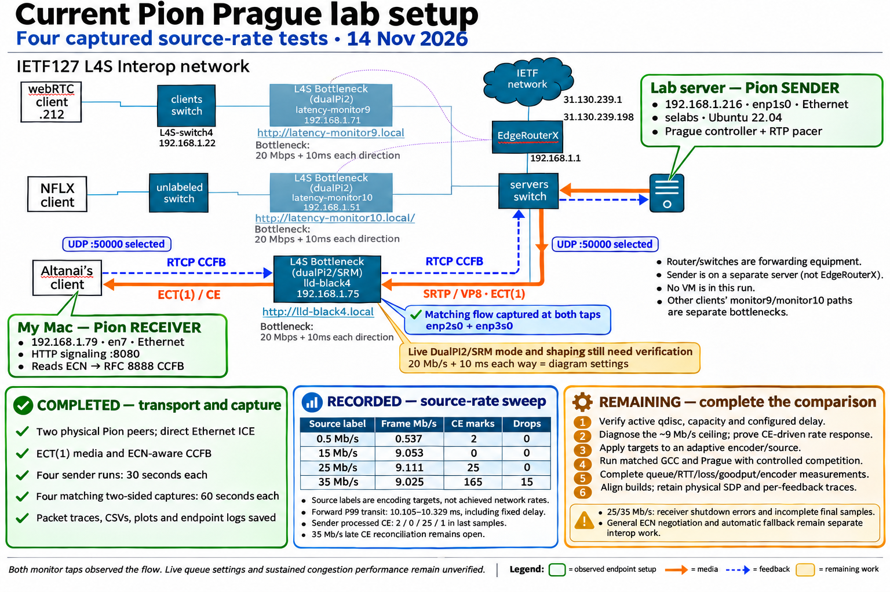

# pion_congestioncontrol_L4S

A Pion endpoint for L4S WebRTC interop at the IETF 127 Hackathon.

Open [`index.html`](index.html) locally in a browser for the complete proposal, architecture, network overlay, experiment plan, blank results table, and lessons. The page embeds the supplied network diagram and works offline.

## Local checkout

Use `/Users/albisht/ietf/pion-l4s-interop` as the working repository. All build and testbed scripts resolve paths from this checkout; temporary validation directories are not required.

## Status

A runnable Pion sender/receiver supports GCC and an experimental UDP-Prague controller. Prague includes synchronous pacing, IPv4 ECT(1) marking, received ECN metadata, ECN-aware RFC 8888 feedback, a cgo bridge to the UDP-Prague core, and controller rate/window updates. A physical Linux-to-Mac call established the complete endpoint loop: ECT(1) media reached the receiver, CE observations returned in CCFB, and the sender recorded them in Prague state.

A later [four-rate physical sweep](results/preview/prague-rate-sweep-20261114.json) ran nominal 0.5, 14.2, 24.0, and 33.8 Mbps VP8 sources with a separate two-sided `lld-black4` capture for each run. Monitor rates were 0.537, 9.053, 9.111, and 9.025 Mbps, with 2, 0, 25, and 165 CE marks respectively. The captures verify the media flow across the monitor's two interfaces. They do **not** yet establish the active qdisc/capacity configuration, pure queue delay, a complete high-load Prague response, or the cause of the roughly 9 Mbps delivery ceiling. The fixed prerecorded source has no encoder adaptation, background traffic was uncontrolled, and the final high-rate sender snapshot missed most of a late CE burst.

See the [Prague implementation status](docs/pion-l4s-interop/prague.md), [runtime component map](docs/pion-l4s-interop/components.md), and [recorded result index](results/preview/README.md). A GCC baseline and one exploratory GCC-versus-Prague comparison have run. The comparison used the same prerecorded source and duration, but lacked repetitions, verified matching bottleneck settings, and controlled cross traffic; it is not a controlled performance comparison. See the [comparison report](results/preview/pion-prague-vs-gcc-25m-20261115T172333Z.md). Historical local GCC/CCFB and GCC/TWCC transport checks remain in the [local snapshot](results/preview/local-gcc-20261114.json).

## Runnable starter

New calls can [record SDP and Pion feedback handling](docs/pion-l4s-interop/recordings.md).
The testbed and local-smoke runners enable private session recordings automatically;
review the retained redacted SDP and controller trace from the new local validation.

```sh
bash scripts/build.sh
./bin/pion-l4s --help
```

See [build and fork instructions](docs/pion-l4s-interop/build-system.md) for the video input, laptop receiver, lab sender, loopback checks, and how to develop local Pion library forks with a Go workspace. The current `--controller gcc` starter uses a fixed prerecorded source and GCC pacing; it is not yet a complete L4S implementation or a valid adaptive-encoder performance comparison. Use `--controller prague --feedback ccfb` on both peers with explicit `--local-ip` and `--interface`; see [Prague setup](docs/pion-l4s-interop/prague.md). Building now requires cgo and a C++11 compiler.

The build selects [`altanai/interceptor`](https://github.com/altanai/interceptor) at `v0.1.51` and [`altanai/ice`](https://github.com/altanai/ice) at `v4.4.8` through versioned `go.mod` replacements. Keep the original Pion import/module paths. The forks currently contain the existing controller/transport implementation; they do not add ECN by themselves.

## Testbed scripts

Use the Codex skill [`$pion-prague-testbed`](.agents/skills/pion-prague-testbed/SKILL.md) to rerun with a bottleneck recording. It starts one bounded lld-black4 capture, confirms capture is active before sending media, then correlates the new dashboard results with both endpoint logs. `testbed.py` by itself does not start a monitor capture.

For a separate sender laptop, follow the [complete two-laptop procedure](docs/pion-l4s-interop/separate-laptop.md),
including copying the current implementation, sharing config and verifying CE feedback.
The [current setup overlay](docs/images/pion-current-lab-setup.md) shows the installed sender at `192.168.1.216` (`enp1s0`) and Mac receiver at `192.168.1.79` (`en7`), observed results, and remaining gaps. The server is installed under `/home/selabs/pion-l4s-interop`; SSH uses `ssh -F /dev/null selabs@192.168.1.216`. Both endpoints are available; the exact transparent bottleneck path still requires operator evidence. See the [recorded physical run](results/preview/prague-lab-selabs216-20261114.json).



### Latest captured Prague sweep

| Nominal source | Receiver RTP payload | Monitor UDP frames | Receiver/monitor CE | Interpretation |
| ---: | ---: | ---: | ---: | --- |
| 0.50 Mbps | 0.496 Mbps | 0.537 Mbps | 2 | Light-load endpoint and CE-feedback check. |
| 14.17 Mbps | 8.497 Mbps | 9.053 Mbps | 0 | Offered source did not reach its nominal rate on the network. |
| 23.95 Mbps | 8.531 Mbps | 9.111 Mbps | 25 | CE was observed at the receiver and in the last sender sample. |
| 33.83 Mbps | 8.408 Mbps | 9.025 Mbps | 165 | Most CE arrived after the last sender snapshot; 15 forward UDP drops were reported by the monitor. |

The [comparison chart](results/preview/prague-rate-sweep-20261114.png), [CSV](results/preview/prague-rate-sweep-20261114.csv), and [full JSON record](results/preview/prague-rate-sweep-20261114.json) preserve the run IDs, artifact hashes, capture links, measurement definitions, shutdown warnings, and missing metrics. Source rate, RTP payload rate, and monitor frame rate use different byte accounting and time windows. These runs are implementation evidence, not a completed performance comparison.

A [separate overlay shows the verified one-Mac local VM loop](docs/images/pion-local-vm-loop.md):
macOS sender on `bridge100` → Linux VM receiver on `lima0`. That call received
437 ECT(1) RTP packets and returned CCFB feedback without traversing lld-black4.
See the [recorded local run](results/preview/mac-to-vm-20261114.json). The current
ignored `testbed/local.json` instead selects the physical `.216` sender and `.79`
receiver. The VM is not in that physical call.

To create your own Linux development server on this Mac, use
[`scripts/server.py`](scripts/server.py); see [server setup and placement](docs/pion-l4s-interop/own-server.md).
Its local VM network does not traverse the physical lab bottleneck. A host on
the servers switch or IETF side is needed for that physical experiment; the
available `.216` host now fills this role.

Use the [testbed run guide](docs/pion-l4s-interop/testbed.md) for the full two-host procedure. The latest supplied diagram places **Altanai's client behind `lld-black4` (`192.168.1.75`)**, with a separate sender at the servers switch.

```text
Server-side Pion sender -> servers switch -> lld-black4 -> laptop Pion receiver
                       <- RTCP feedback across the same path <-
```

### Sender and receiver commands

These commands use the installed Linux sender at `192.168.1.216` (`enp1s0`) and Mac receiver at `192.168.1.79` (`en7`). Recheck those assigned addresses before running. For a new setup, copy `testbed/lld-black4.example.json` to `testbed/local.json`, fill both endpoint sections, and place the same edited config on both hosts. Preserve the existing lab config when rerunning.

**Prepare before starting a capture.** Put the same source revision on both hosts and run `bash scripts/build.sh` in each checkout. On the installed Linux sender, add its private Go toolchain first with `export PATH="$HOME/.local/share/pion-toolchains/go1.27.4/bin:$PATH"`. The sender must have the file named by `video`; run `bash scripts/make-media.sh` only if you need to create the default `media/sample.ivf`. It refuses to overwrite an existing clip.

**Choose the controller in `testbed/local.json` on both hosts:**

| Experiment | `controller` | `feedback` | Example run ID |
| --- | --- | --- | --- |
| With Prague | `prague` | `ccfb` | `prague-compare-01` |
| Without Prague, using GCC | `gcc` | `ccfb` | `gcc-compare-01` |

The run ID names the saved artifacts; it does **not** select the controller. There is no fixed-rate/no-congestion-control mode yet. Keep the same `video`, `duration_seconds`, and `initial_bitrate_bps` for the matched runs; `initial_bitrate_bps` is a starting controller target, not an encoder or guaranteed wire rate. The current light-load config uses 30 seconds and `media/sample.ivf` at approximately 500 kbps.

**With Prague — start the receiver on the Mac and leave it running:**

```sh
cd /Users/albisht/ietf/pion-l4s-interop
python3 scripts/testbed.py plan
python3 scripts/testbed.py doctor --role receiver
python3 scripts/testbed.py run --role receiver --run-id prague-compare-01
```

**In a separate terminal, connect to the sender and check readiness:**

```sh
ssh -F /dev/null selabs@192.168.1.216
cd /home/selabs/pion-l4s-interop
./run-testbed.sh doctor --role sender
```

Start a uniquely named, bounded capture in the [lld-black4 UI](http://lld-black4.local/ui/) and confirm it is actively recording. Then, in that SSH session, launch the sender:

```sh
./run-testbed.sh run --role sender --run-id prague-compare-01
```

The installed server's `run-testbed.sh` supplies its private Go toolchain and invokes `scripts/testbed.py`. On another sender with Go already on `PATH`, use `python3 scripts/testbed.py` in place of `./run-testbed.sh`. Both peers must use the same config and run ID. After the sender finishes, stop the receiver with Ctrl+C and wait for monitor analysis.

**Without Prague — repeat with GCC.** Set `controller` to `gcc` in both configs, keep `feedback` as `ccfb`, and start a fresh receiver on the Mac:

```sh
cd /Users/albisht/ietf/pion-l4s-interop
python3 scripts/testbed.py plan
python3 scripts/testbed.py doctor --role receiver
python3 scripts/testbed.py run --role receiver --run-id gcc-compare-01
```

In the sender's SSH session:

```sh
cd /home/selabs/pion-l4s-interop
./run-testbed.sh doctor --role sender
# Start a separate lld-black4 capture and confirm it is active before continuing.
./run-testbed.sh run --role sender --run-id gcc-compare-01
```

Use a new run ID and a fresh receiver for every repeat. The helper verifies the compiled Altanai replacements, filters ICE to the configured interface/IP and UDP ports, and records logs, build details, config, hashes, and session recordings under `results/raw/<run-id>/receiver/` on the Mac and `results/raw/<run-id>/sender/` on the server. It never overwrites an existing run. `testbed.py` does not start the bottleneck capture automatically.

Allow TCP 8080 on the receiver and UDP 50000–50100 on both peers, or configure operator-approved ports. Scripts inspect the local network; they do not configure lab gear, routes, host addresses, or firewalls. Endpoint checks cannot prove passage through a transparent bottleneck: confirm the flow in monitor captures. Prague enables the application's ECT(1)/CE path; GCC does not, so this compares the complete transport modes. The roughly 9 Mbps Prague delivery ceiling remains unresolved and limits capacity conclusions.

## POC objective

Compare Prague through DualPI2 against an explicitly configured Pion GCC baseline, using the same bottleneck and media source. Measure queue delay, RTT variation, CE counts, loss, goodput, and encoder target rate.

## Endpoint choice

Use Pion for both sender and receiver in the initial POC. This gives control over the sender's congestion controller, the receiver's ECN observation and RFC 8888 feedback, and logging at both ends.

Treat the existing WebRTC client labelled `.212` in the network diagram as a later interoperability target. Confirm its application, negotiated feedback, and ECN capability before using it as the receiver for a Prague experiment. The diagram alone does not establish those capabilities. Use an organizer-assigned host and address for the Pion receiver.


## Connect the peers to the test network

1. **Confirm the physical ports.** Connect the laptop receiver to the client-side Ethernet attachment on Altanai's `lld-black4` branch and the separate sender host to the servers switch. The operator should confirm this crosses the intended shaped path. The monitor9 client switch is a separate branch. No Pion API runs on a switch.
2. **Obtain host addresses.** Use lab DHCP or the operator's assigned IP address, subnet, and gateway. Do not copy `.212` onto a second host. `192.168.1.75` labels `lld-black4` management and is not the Pion receiver's address or an assumed gateway.
3. **Check reachability on Ethernet.** Inspect each host's address and the route to the other host. Allow the selected ICE UDP port range through the host firewall. Ordinary reachability checks establish connectivity; they do not prove that the media takes the shaped path.
4. **Configure ICE for the lab.** The helper passes `--interface`, `--local-ip`, and a UDP port range. Pion's `SettingEngine` applies interface/IP filters, IPv4 UDP host candidates and the port range. Use direct host connectivity when the lab permits it.
5. **Exchange signaling.** Run a small HTTP or WebSocket signaling service on a reachable endpoint. Exchange the SDP offer, SDP answer, and ICE candidates; alternatively, gather candidates completely before exchanging SDP. Agree on the codec and the intended RTCP feedback. The signaling service does not carry the media.
6. **Verify the selected media path.** Wait for the PeerConnection to connect, then inspect the logged selected ICE candidate pair. Confirm it uses the two lab Ethernet addresses, and correlate traffic with `lld-black4` captures or counters. Check with the operator when confirming a bridge path; traceroute may not show a transparent bottleneck.
7. **Run the experiment.** Send video from the server-side Pion host to the client-side Pion host; RTCP feedback returns across the same bottleneck. Run GCC and Prague separately with matched conditions. Validate ECT(1), received CE marks, and CE feedback for Prague. Use a rate-adaptable source, or repeatable media representations selected by the target rate, if measuring encoder adaptation.

The supplied topology labels `lld-black4` as **20 Mbps with 10 ms added in each direction**. Confirm its live settings and DualPI2/SRM mode with the operator. The configured delay adds roughly 20 ms to RTT before queuing. Put competing traffic through `lld-black4` as well: monitor9 and the Netflix branch through monitor10 have separate bottlenecks.

## UDP-Prague endpoint mapping

See [the Pion-to-UDP-Prague comparison](docs/pion-l4s-interop/udp-prague-pion-mapping.md) for how the example sender and receiver map to the planned WebRTC endpoints, and which feedback and ECN adaptations are required.

The WebRTC module is pinned to `v4.2.26` and interceptor to `v0.1.51`.

## Implementation status

- [x] Pion sender and receiver with direct IPv4 ICE/UDP, HTTP signaling, VP8 RTP, and structured logs.
- [x] Explicit GCC controller and pacer for the baseline mode.
- [x] UDP-Prague core, Go/cgo adapter, RTP packet accounting, synchronous pacing, and byte-window enforcement.
- [x] Outer-IP ECT(1) marking for media, received ECN metadata, authenticated RTP correlation, and CE-aware RFC 8888 CCFB.
- [x] Physical Linux-to-Mac media/feedback runs and paired `lld-black4` capture artifacts.
- [x] Local SDP and controller-feedback recording with redacted shareable artifacts.
- [ ] Live encoder/source adaptation driven by the selected controller.
- [ ] Independent confirmation of the active qdisc, shaping capacity, and marking configuration.
- [ ] Controlled matched physical GCC and Prague runs with verified bottleneck settings and cross traffic.
- [ ] Pure queue delay, raw RTT variation, fairness, and negative-case validation.

## Pion L4S integration TODOs

These tasks track the bridge from the standalone [UDP-Prague sender/receiver](https://github.com/L4steam/udp_prague) to Pion. The experimental adapter and local ECN feedback path are implemented; physical lab validation and source adaptation remain pending. See the [endpoint mapping](docs/pion-l4s-interop/udp-prague-pion-mapping.md) for the design comparison.

### TODO 1 — Pin and inspect the interfaces

- [x] Select and record the Pion WebRTC, ICE, interceptor, and UDP-Prague revisions.
- [x] Confirm which RTCP RFC 8888 report format is negotiated and what packet identity, timing, and ECN information it carries.
- [x] Map the selected report fields to the exact `PragueCC` API calls and document units, counter semantics, and wrap behavior.

**Done when:** a short interface note names the versions and describes the sender and receiver data flow field by field.

### TODO 2 — Build packet and feedback adapters

- [x] Track outgoing RTP packet identity, send time, size, and in-flight state for Prague accounting.
- [x] Parse incoming receiver feedback and correlate it with the tracked RTP packets.
- [x] Handle loss, reordering, duplicate/late reports, and sequence/counter wrap without double-counting.
- [x] Translate received, lost, CE, and timing information into the selected Prague API calls.

**Done when:** a deterministic trace demonstrates that known packet/feedback inputs produce the expected Prague controller inputs and accounting.

### TODO 3 — Apply Prague output to media

- [x] Connect Prague's pacing rate and burst/window limits to Pion's RTP send path.
- [ ] Connect its target rate to a rate-controllable media source or encoder.
- [x] Ensure GCC cannot also control the same stream during a Prague run.
- [ ] Log requested controller rate, applied pacer rate, and encoder/source target for comparison.

**Done when:** logs show the controller's rate changes reaching the pacer and source, with no competing sender controller.

### TODO 4 — Expose outer-IP ECN

- [x] Mark outgoing SRTP media packets ECT(1) for the Prague run while keeping ICE control traffic Non-ECT.
- [x] Read the ECN field on received outer IP packets and expose CE observations to receiver feedback generation.
- [x] Detect and report bleaching or invalid ECN behavior.
- [x] Verify the behavior on the selected Linux-to-macOS ICE/UDP path.

**Done when:** packet captures show ECT(1) before the bottleneck, CE after marking, and matching CE information in receiver feedback.

### TODO 5 — Prove the closed loop

- [x] Correlate packet captures, receiver feedback, Prague state, and controller rate changes; the November 15 run records 324 CE marks and 13 losses reaching sender state as the rate falls.
- [ ] Correlate the applied pacer rate and adaptive encoder/source target with those events; the source is fixed prerecorded media and its target is not available.
- [x] Observe sender rate reduction after reported congestion in the physical run (CE and loss both occurred).
- [ ] Exercise reordering and CE bleaching/invalid-ECN cases, and verify fallback when feedback reports an ECN error.

**Done when:** a timestamped trace follows an observed bottleneck mark through receiver feedback into Prague's state and applied sending rate; negative cases are distinguishable.

### TODO 6 — Run matched comparisons

- [x] Run an exploratory GCC and Prague comparison using the same media file and 30-second duration.
- [ ] Repeat with verified identical capacity and delay, controlled cross traffic, and multiple runs.
- [x] Record transit delay, CE count, packet loss, and delivered media rate for the exploratory comparison.
- [ ] Measure pure queue delay and raw RTT variation, and correlate an adaptive encoder/source target rate.
- [ ] Repeat with a classic competing flow and diagnostic cases such as ECN bleaching or a non-L4S queue.
- [x] Preserve the run configuration and endpoint/network logs with each result.

**Done when:** the paired runs are reproducible from recorded configuration and all listed measurements can be traced to endpoint or bottleneck evidence.


## Contribution workflow

See [`CONTRIBUTING.md`](CONTRIBUTING.md) for the repository and fork workflow. Use a feature branch based on `origin/main` and submit changes through a pull request. Keep a file overview and purpose comments/docstrings on every function when adding code.

## References

- [RFC 9330: L4S architecture](https://www.rfc-editor.org/rfc/rfc9330.html)
- [RFC 9331: L4S ECN](https://www.rfc-editor.org/rfc/rfc9331.html)
- [RFC 9332: DualQ coupled AQM](https://www.rfc-editor.org/rfc/rfc9332.html)
- [RFC 8888: RTP congestion-control feedback](https://www.rfc-editor.org/rfc/rfc8888.html)
- [RFC 9768: TCP AccECN](https://www.rfc-editor.org/rfc/rfc9768.html), implemented separately from the WebRTC endpoint
- [Pion ICE and network configuration](https://github.com/pion/webrtc/blob/main/settingengine.go)
