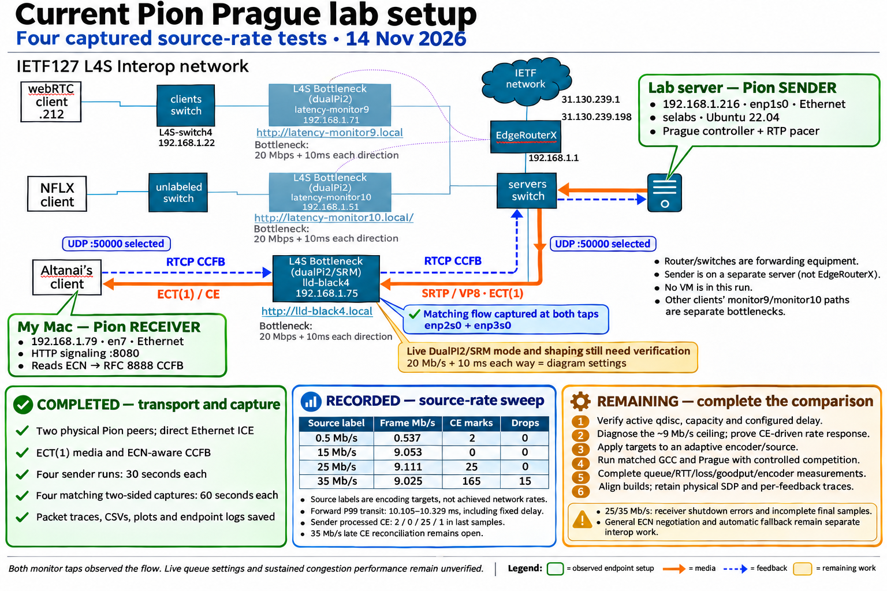

# Current physical Pion Prague setup



Updated on 15 November 2026 from the capture-backed runs recorded on 14 November. The separate sender runs on `selabs@192.168.1.216` (`enp1s0`), installed under `/home/selabs/pion-l4s-interop`. The Mac receiver uses `192.168.1.79` (`en7`). The user places the server at the servers switch and the Mac behind lld-black4. No VM participates in these physical runs.

## Completed and recorded

- Both physical Pion peers are installed and select their Ethernet ICE addresses on UDP 50000.
- ECT(1) media and ECN-aware RFC 8888 CCFB operate on the paired path.
- Four 30-second sender runs each have a separate matching 60-second two-sided lld-black4 capture. The flow appears at both monitored interfaces, `enp2s0` and `enp3s0`.
- The monitor retains PCAPNG traces, per-flow CSVs and PDF plots; local artifacts retain endpoint logs, configs, hashes and process outcomes.
- Higher source-rate cases and partial performance measurements are now recorded. This replaces the old diagram's wholly pending capture/load tasks with the narrower open requirements below.

| Source-rate label | Monitor frame rate (Mbps) | Monitor CE | Sender CE, last sample | Forward UDP drops |
| --- | ---: | ---: | ---: | ---: |
| 0.5 Mbps | 0.537 | 2 | 2 | 0 |
| 15 Mbps | 9.053 | 0 | 0 | 0 |
| 25 Mbps | 9.111 | 25 | 25 | 0 |
| 35 Mbps | 9.025 | 165 | 1 | 15 |

Source labels name encoder targets, not achieved network rates. The actual encoded source rates were approximately 0.500, 14.167, 23.951 and 33.832 Mbps. Forward P99 transit ranged from 10.105 to 10.329 ms, including fixed delay; these are not direct pure queue-delay measurements. See the [captured source-rate sweep and limitations](../../results/preview/prague-rate-sweep-20261114.json).

The 25/35 Mbps receivers logged closed-pipe errors during peer shutdown, leaving incomplete final periodic samples. The 35 Mbps capture's late CE burst was not fully reconciled with the last sender snapshot. These runs establish CE observation and some sender processing, not a proved CE-caused reduction in actual sending rate. Uncontrolled background flows were also present.

## Remaining validation and implementation

1. Verify live DualPI2/SRM mode, shaping capacity and configured delay with operator evidence. Both tap observations support path traversal but do not establish the active AQM or capacity. The diagram's 20 Mbps / 10 ms per direction remains an unverified configuration reference.
2. Diagnose the approximately 9 Mbps delivery ceiling and correlate sustained CE with controller, pacer and actual sending-rate changes under controlled conditions.
3. Connect the controller target to an adaptive encoder or controllable media source; the current VP8 files remain fixed.
4. Run matched physical GCC and Prague cases with the same bottleneck/source and controlled competing traffic.
5. Complete queue-delay, RTT-variation, final loss, deduplicated goodput and encoder-target measurements. Preserve already recorded transit, CE, monitor-drop and throughput evidence as partial measurements.
6. Align the source/dependency builds and use the physical SDP/per-feedback recorder on both endpoints; retain final feedback processing before shutdown.

General ECN negotiation and dynamic fallback remain separate interoperability work. The current paired application checks ECN capability and stops on invalid ECN or feedback failure. The [earlier 17:00 PST endpoint-only check](../../results/preview/prague-lab-selabs216-20261114.json), which received 2,078 RTP including 2 CE, remains historical evidence separate from these captured runs.

## Image provenance

Generated with the built-in imagegen tool from the supplied topology. A second edit corrected arrow directions at the servers switch. On 15 November, a built-in imagegen edit replaced the old single-call status panels with completed capture checks, the four-rate result table and the narrower remaining work. The updated numbers, endpoint addresses and media/feedback arrow directions were visually reviewed. Original diagram: `codex-clipboard-06c525df-6f78-4ac0-8c24-0843947ecab8.png`.

## Update prompt (15 November 2026)

```text
Use case: text-localization; technical network infographic update.
Asset type: existing project status overlay embedded in an offline HTML report.
Input image: the referenced /Users/albisht/ietf/pion-l4s-interop/docs/images/pion-current-lab-setup.png is the EDIT TARGET, not just a style reference.

Update this existing image to reflect completed capture-backed experiments. Preserve the recognizable original IETF127 topology, all equipment names/IPs, the relative node positions and the separate monitor9/monitor10 branches. Preserve the lower active branch and correct arrow directions. You may extend the canvas downward, keeping the topology legible, to give the revised evidence panels sufficient space. Use crisp technical typography, white background, green completed checks, blue data table, amber remaining work. Keep text readable at full size; no overlaps or tiny compressed paragraphs.

Keep title: "Current Pion Prague lab setup"
Replace old single-call subtitle with: "Four captured source-rate tests · 14 Nov 2026"

Preserve endpoint callouts:
"My Mac — Pion RECEIVER"
"192.168.1.79 · en7 · Ethernet"
"HTTP signaling :8080"
"Reads ECN → RFC 8888 CCFB"
"Lab server — Pion SENDER"
"192.168.1.216 · enp1s0 · Ethernet"
"selabs · Ubuntu 22.04"
"Prague controller + RTP pacer"
Preserve lld-black4 at 192.168.1.75, management address only. Preserve the servers switch and separate lab sender to its right. Do not put sender on router or monitor. No VM participates.
ORANGE media must run sender LEFT to servers switch, then DOWN toward lower branch, then LEFT through lld-black4 to Mac. BLUE DASHED CCFB must run Mac RIGHT through lld-black4, then UP to servers switch and RIGHT to sender. Keep UDP :50000 selected at both ends. Label pre-bottleneck media "SRTP / VP8 · ECT(1)" and receiver-side media "ECT(1) / CE". Label reverse traffic "RTCP CCFB".
Replace any suggestion that capture/path observation is wholly missing with a blue note near lld-black4: "Matching flow captured at both taps" and "enp2s0 + enp3s0". Keep separate amber note: "Live DualPI2/SRM mode and shaping still need verification" and "20 Mb/s + 10 ms each way = diagram settings".

Replace the old bottom VERIFIED and STILL NEEDED panels with three readable evidence areas, extending canvas downward as needed:

GREEN PANEL, exact heading "COMPLETED — transport and capture"
Lines:
"Two physical Pion peers; direct Ethernet ICE"
"ECT(1) media and ECN-aware CCFB"
"Four sender runs: 30 seconds each"
"Four matching two-sided captures: 60 seconds each"
"Packet traces, CSVs, plots and endpoint logs saved"

BLUE PANEL, heading "RECORDED — source-rate sweep"
A clean aligned table with EXACT column headings and values:
"Source label | Frame Mb/s | CE marks | Drops"
"0.5 Mb/s | 0.537 | 2 | 0"
"15 Mb/s | 9.053 | 0 | 0"
"25 Mb/s | 9.111 | 25 | 0"
"35 Mb/s | 9.025 | 165 | 15"
Below table:
"Source labels are encoding targets, not achieved network rates."
"Forward P99 transit: 10.105–10.329 ms, including fixed delay."
"Sender processed CE: 2 / 0 / 25 / 1 in last samples."
"35 Mb/s late CE reconciliation remains open."

AMBER PANEL, exact heading "REMAINING — complete the comparison"
Lines:
"1  Verify active qdisc, capacity and configured delay."
"2  Diagnose the ~9 Mb/s ceiling; prove CE-driven rate response."
"3  Apply targets to an adaptive encoder/source."
"4  Run matched GCC and Prague with controlled competition."
"5  Complete queue/RTT/loss/goodput/encoder measurements."
"6  Align builds; retain physical SDP and per-feedback traces."

Small data-quality note, clearly visible:
"25/35 Mb/s: receiver shutdown errors and incomplete final samples."
"General ECN negotiation and automatic fallback remain separate interop work."

Footer:
"Both monitor taps observed the flow. Live queue settings and sustained congestion performance remain unverified."

Do not claim all receiver runs exited cleanly, all 165 CE marks reached sender state, a verified 20 Mb/s capacity, an implemented adaptive encoder, a completed physical GCC baseline, or proven congestion-performance improvement. Keep the old original topology recognizable. No invented hosts, no secrets, no decorative clutter.
```

## Original generation prompt (historical)

```text
Use case: compositing; infographic-diagram.
Edit target: the attached original IETF127 L4S Interop network diagram. Create an updated, legible annotated overlay for the actual current Pion setup. Preserve the original network topology, node positions, equipment names and management IPs. Extend canvas at right and bottom for clear callouts; no overlapping text. Upper monitor9/monitor10 branches may be faded to give the lower active branch emphasis. White background, crisp technical diagram, large readable typography. Keep the original diagram recognizable.

Title: "Current Pion Prague lab setup"
Subtitle: "30-second two-host check completed · 14 Nov 2026"

Current endpoints:
1. At bottom-left Altanai's client, attach a green-outlined callout:
"My Mac — Pion RECEIVER"
"192.168.1.79 · en7 · Ethernet"
"HTTP signaling :8080"
"Reads ECN → RFC 8888 CCFB"
"python3 scripts/testbed.py run --role receiver"
2. Add a separate server/computer to the RIGHT of the servers switch, cabled directly to that switch, with green outlined callout:
"Lab server — Pion SENDER"
"192.168.1.216 · enp1s0 · Ethernet"
"selabs · Ubuntu 22.04"
"Prague controller + RTP pacer"
"~/pion-l4s-interop/run-testbed.sh run --role sender"
"Installed; build and checks passed"

Highlight exactly the physical LOWER branch only: server -> servers switch -> lld-black4 -> Mac using thick ORANGE directional arrows. Label "SRTP / VP8 · ECT(1)". The arrowheads point TOWARD the Mac. Add BLUE DASHED arrows in reverse Mac -> lld-black4 -> servers switch -> server, label "RTCP CCFB · received ECN". Label both ends "UDP :50000 selected". Include a small grey SSH control note "Mac → selabs@192.168.1.216 · TCP 22 (control)" without drawing any route bypassing the bottleneck.
Keep lld-black4 "192.168.1.75" and add amber note "Management address only". Label "DualPI2/SRM reported by user; verify live settings" and "Diagram: 20 Mb/s + 10 ms each way".
Router/switches are forwarding equipment; do not place sender on EdgeRouterX. No VM is in this run. Other clients' monitor9/monitor10 paths are separate bottlenecks.

Bottom green evidence panel, exact text:
"VERIFIED — endpoint transport + ECN feedback"
"30 s · 2,078 RTP received"
"2,076 ECT(1) + 2 CE · 0 Non-ECT"
"Sender Prague recorded both CE marks"
"Direct ICE: 192.168.1.216 ↔ 192.168.1.79"
"Fixed VP8 ≈ 0.5 Mb/s; this does not measure link capacity."

Bottom amber panel, exact text:
"STILL NEEDED — complete Prague experiment"
"1  Confirm lld-black4 forwarding path, live qdisc and shaping with operator captures/counters."
"2  Apply controlled load on this same branch; measure sustained CE and rate response."
"3  Connect controller target to an adaptive encoder or rate-controllable source."
"4  Record queue delay, RTT variation, loss, goodput and encoder target; run matched GCC baseline."
"5  General WebRTC interop: standards-based ECN negotiation and fallback remain."
Footer: "The ECN loop is observed. The marking device and congestion performance are not yet independently established."
Legend: green = observed endpoint setup; orange = media; blue dashed = feedback; amber = missing validation/features.
Do not add claims of completed congestion benchmarking, verified qdisc, or measured 20 Mb/s capacity. No passwords.
```

## Arrow correction prompt

```text
Use case: precise-object-edit, technical network diagram. Edit ONLY the directional traffic arrows on this generated current-setup diagram. Keep all text, numbers, counts, labels, layout, nodes, title, panels and colors unchanged.
Correct the ORANGE media path so it visibly runs from the Pion SENDER server icon on the right LEFTWARD into the servers switch, then DOWNWARD from the switch toward lld-black4, then LEFTWARD into lld-black4 and LEFTWARD into the Mac. Specifically the existing orange arrowhead immediately below the servers switch currently points UP, which is incorrect: remove that upward orange arrowhead. Put a DOWNWARD orange arrowhead midway along the vertical orange segment between switch and the bend. Retain leftward orange arrowheads entering lld-black4 and Mac. Add an orange leftward arrowhead on the horizontal link from the server icon into the switch.
The BLUE DASHED feedback path must visibly run from the Mac RIGHTWARD into lld-black4, then RIGHTWARD and UPWARD toward the switch, then RIGHTWARD from the switch into the sender server icon. Keep upward blue arrowhead at switch, add a dashed blue rightward arrow on the switch-to-server horizontal segment, offset from the orange reverse arrow for readability.
Only this arrow correction; do not reword any content or change diagram connections. All arrows must agree with legend: orange media server→Mac; blue feedback Mac→server.
```
