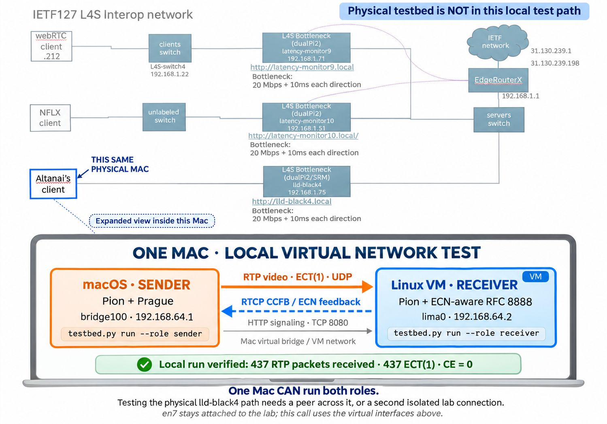

# One-Mac local VM test overlay

Both endpoints run on the same physical Mac. macOS sends from
`bridge100` / `192.168.64.1`; the Linux VM receives on `lima0` /
`192.168.64.2`. The VM's Lima instance is named `pion-sender`, but its application
role for this call is **receiver**. The selected ICE pair used UDP port 50000
at both ends. HTTP signaling used TCP 8080 on the VM.

The ten-second sender process completed successfully. The receiver's last
sample contained 437 RTP packets, all ECT(1), with zero CE and zero Non-ECT.
The sender's last periodic sample contained 190 congestion-feedback reports.
These samples have independent timestamps and are not synchronized final totals.
See [the recorded run](../../results/preview/mac-to-vm-20261114.json).

This call stayed on the local virtual network. It did not traverse en7, the
servers switch, or lld-black4. One Mac can run both application roles, including
as two local processes. A physical bottleneck test with the present client-side
Ethernet attachment requires a peer on the other side, or a second isolated
connection. Special VLAN/routing arrangements could change that requirement;
they are not configured by this project.

Created with the built-in image generation tool from the supplied original
topology. The separate [two-laptop overlay](pion-testbed-placement.png) describes
the physical testbed placement.

## Generation prompt

Use case: precise-object-edit / infographic-diagram.
Edit the attached original IETF127 network topology to show the ACTUAL LOCAL VM TEST ON ONE MAC. Preserve all original devices, labels, addresses and wires, with the physical topology gently desaturated/faded but still readable. Extend the white canvas BELOW the original diagram for a large explanatory inset. Do NOT add a second physical laptop or route colored test arrows through any physical lab device. This image must make clear that ONE PHYSICAL MAC can run both sender and receiver.

Original topology upper portion:
- Highlight only the existing bottom-left "Altanai’s client" box with a blue outline. Label nearby "THIS SAME PHYSICAL MAC".
- Keep its original cable to lld-black4 thin gray, without traffic arrows.
- Add a prominent but unobtrusive banner in the top/right margin: "Physical testbed is NOT in this local test path".
- Keep router, switches, monitor9, monitor10, and lld-black4 readable in the faded background. Do not erase/change their original IP labels.
- Link the highlighted Altanai Mac box to the new lower inset with a thin dotted annotation connector labeled "Expanded view inside this Mac".

New bottom inset, wide and beautifully legible, with ONE large laptop/computer boundary enclosing everything below:
Top heading "ONE MAC · LOCAL VIRTUAL NETWORK TEST".
Inside the boundary place two large distinct boxes LEFT and RIGHT:
LEFT orange bordered:
"macOS · SENDER"
"Pion + Prague"
"bridge100 · 192.168.64.1"
"testbed.py run --role sender"
RIGHT blue bordered, visibly labeled as a VM inside the same Mac:
"Linux VM · RECEIVER"
"Pion + ECN-aware RFC 8888"
"lima0 · 192.168.64.2"
"testbed.py run --role receiver"
Between the boxes draw a thick orange arrow pointing RIGHT, labeled "RTP video · ECT(1) · UDP".
Below it draw a thick blue dashed arrow pointing LEFT, labeled "RTCP CCFB / ECN feedback".
A smaller gray arrow pointing RIGHT is labeled "HTTP signaling · TCP 8080".
Use "Mac virtual bridge / VM network" as a small label between nodes. Every colored test path remains INSIDE this one-computer boundary. No path runs toward lld-black4 or the servers switch.
Below boxes within the inset add short factual confirmation:
"Local run verified: 437 RTP packets received · 437 ECT(1) · CE = 0"
Use a small footer outside/under the boundary with two concise statements:
"One Mac CAN run both roles."
"Testing the physical lld-black4 path needs a peer across it, or a second isolated lab connection."
Add small note "en7 stays attached to the lab; this call uses the virtual interfaces above." Do not imply the app's sender uses en7 for this local call.

Style: clean accurate engineering annotation, white background, orange media/sender and blue receiver/feedback, legible typography, spacious inset, preserve original topology as context rather than obscuring it. Distinguish solid orange media from dashed blue reverse feedback. No additional physical machines, no drawn media traffic on physical cables, no claim of physical DualPI2 performance.
