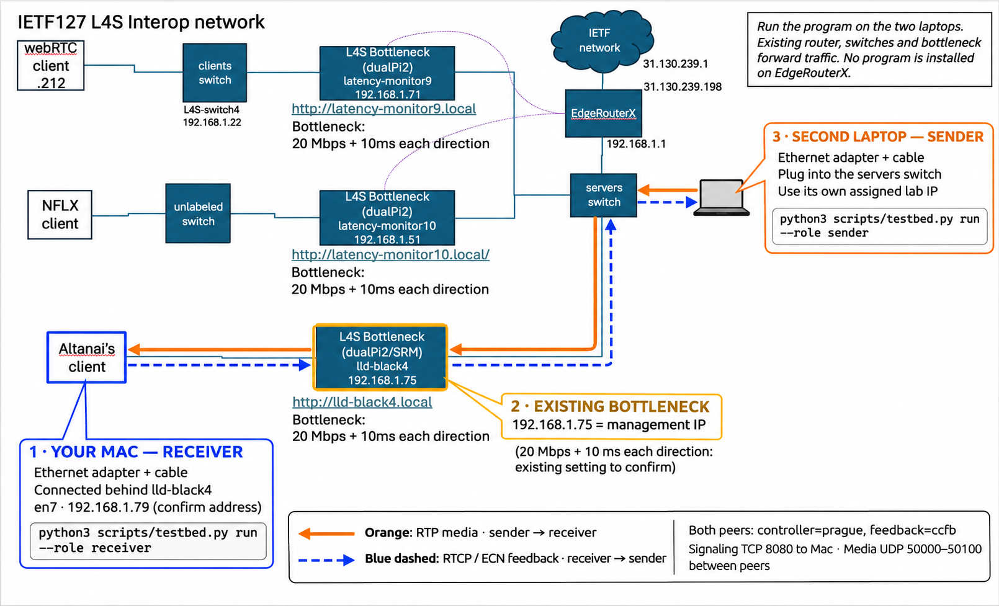

# Two-laptop Pion placement overlay

The supplied IETF127 topology is annotated with the proposed two-laptop
connection. The user's Mac is the receiver behind lld-black4; the second laptop
is the sender attached by Ethernet to the servers switch. Orange arrows show
RTP media; blue dashed arrows show RTCP/ECN feedback. The pictured commands are
line-wrapped labels; run each full command on one shell line, using the shared
configuration described in [the two-laptop guide](../pion-l4s-interop/separate-laptop.md).

The diagram is a placement plan. It does not claim that a physical testbed run
has completed. `192.168.1.75` is the bottleneck management address; the sender
needs its own assigned address. Confirm the Mac's current interface/address and
the active shaping settings before a run.

Created using the built-in image generation tool from the user-supplied
topology image on 14 November 2026. The original topology is retained in the
project HTML's interactive network figure.

## Generation prompt

Use case: precise-object-edit / infographic-diagram.
Edit target: the attached IETF127 L4S Interop network topology image. Create a clear annotated OVERLAY showing exactly where the user's Pion program runs and how two laptops connect. Preserve the existing diagram, all devices, their labels, addresses and existing connections. Do not invent a sender IP. Extend the white canvas to the RIGHT and BOTTOM to fit callouts; keep the original topology large and readable in the upper-left. This is a network experiment placement plan, not a completed experiment.

Make these additions:
1. Blue outline around the existing lower-left "Altanai’s client" box. In the NEW bottom-left margin add a blue-bordered callout headed "1 · YOUR MAC — RECEIVER", with short lines "Ethernet adapter + cable", "Connected behind lld-black4", "en7 · 192.168.1.79 (confirm address)", and a monospace command on two lines "python3 scripts/testbed.py run" / "--role receiver". Point it to Altanai's client. The Mac remains on this lower branch, NOT the .212 branch.
2. Amber outline around existing "lld-black4 192.168.1.75" device, keeping text readable. Add a small label in available white space nearby "2 · EXISTING BOTTLENECK" and "192.168.1.75 = management IP". Existing diagram's 20 Mbps and 10 ms each direction are shown settings to confirm.
3. In the NEW right margin, horizontally aligned with the servers switch, add a simple laptop icon and orange-bordered callout "3 · SECOND LAPTOP — SENDER". Text "Ethernet adapter + cable", "Plug into the servers switch", "Use its own assigned lab IP", then monospace command on two lines "python3 scripts/testbed.py run" / "--role sender". Draw a clear physical attachment from this added laptop to the RIGHT side of the EXISTING servers switch, not the router.
4. Trace the intended MEDIA path with thick ORANGE SOLID directional arrows: from new sender laptop LEFT into servers switch; from bottom of servers switch DOWN its existing vertical connection then LEFT along the bottom branch into lld-black4; then LEFT from lld-black4 into Altanai's client. Do not draw routes through monitor9 or monitor10. Avoid drawing over device text; trace between devices and highlight the relevant device outlines.
5. Trace parallel BLUE DASHED directional arrows in the REVERSE direction for RTCP/ECN feedback: Altanai's client RIGHT toward lld-black4, RIGHT along lower branch then UP into servers switch, then RIGHT into sender laptop. Keep the two paths distinct and arrowheads correct.
6. In the NEW bottom margin add a compact legend: "Orange: RTP media · sender → receiver" and "Blue dashed: RTCP / ECN feedback · receiver → sender". A small note says "Both peers: controller=prague, feedback=ccfb" and "Signaling TCP 8080 to Mac · Media UDP 50000–50100 between peers".
7. Small unobtrusive note in the NEW upper-right margin: "Run the program on the two laptops. Existing router, switches and bottleneck forward traffic." No program is installed on EdgeRouterX.

Style: precise technical annotation, flat clean lines, black/dark text, white callout backgrounds, orange for sender/media, blue for receiver/feedback, amber for bottleneck. Spacious readable typography. Preserve all original network branches and original labels exactly; add the overlay around them. Make it understandable at a glance. No charts, no measurement claims, no decorative photos.
