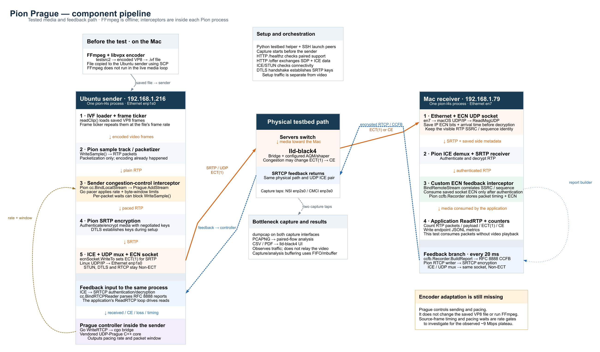

# Components acting on the Pion Prague flow



[Scalable SVG](../images/pion-flow-components.svg) · [Editable Graphviz source](../images/pion-flow-components.dot)

This diagram follows the Prague/CCFB implementation used by the captured physical tests, pinned to source commit `e53d23f`. The sender runs on Ubuntu `192.168.1.216` / `enp1s0`; the Mac receiver uses `192.168.1.79` / `en7`. The paired capture verifies the media flow across lld-black4's two monitored interfaces. Its live qdisc mode and configured capacity remain separate configuration evidence.

## File preparation happens before the call

FFmpeg runs on the Mac to create the input, using its libvpx VP8 encoder. It writes already encoded VP8 frames into an IVF container. We then copy that file to the Ubuntu sender. The server does not need FFmpeg to replay it.

The source's nominal bitrate comes from encoded frame bytes divided by playback duration. During a call, the Pion application loads the file into memory and loops the stored frames using a frame ticker. It cannot ask an already encoded file to change quality or bitrate. Synchronous pacing can block the caller and change the actual frame production cadence.

The original 0.5 Mbps smoke generator and the recovered high-load sweep recipes are now named profiles in [scripts/make-media.sh](../../scripts/make-media.sh) / [media_source.py](../../scripts/media_source.py). Use `--profile load25m` for the two-second noisy 720p60 input. [Historical provenance](../../testbed/media-provenance/historical-25m.json) identifies the original 23.950988 Mbps clip; regenerate once and share its hash for a new matched pair. The [tool index](../../scripts/README.md) covers generation, sender deployment, capture and the exact scripts used in today's runs.

## Runtime media pipeline

```mermaid
flowchart LR
    FF["Mac, before test: FFmpeg + libvpx"] --> IVF["VP8 IVF file"]
    IVF -->|"copy to sender"| APP["Sender: IVF loader + frame ticker"]
    APP --> RTP["Pion WriteSample / RTP packetizer"]
    RTP --> CC["Sender CC interceptor + Prague pacer"]
    CC --> TX["SRTP encryption → ICE/UDP mux → ECN socket"]
    TX -->|"SRTP / UDP, ECT(1)"| NET["Servers switch → lld-black4"]
    NET --> RX["Mac ECN socket → ICE demux → SRTP authentication"]
    RX --> OBS["Receiver ECN feedback interceptor"]
    OBS --> COUNTERS["Application ReadRTP / counters"]
    OBS --> FB["CCFB every 20 ms → SRTCP encryption"]
    FB -->|"same network path, reverse direction"| RTCP["Sender SRTCP decode + CC RTCP reader"]
    RTCP --> CORE["Go adapter → cgo → UDP-Prague C++ core"]
    CORE -->|"rate + window"| CC
```



| Component | Where it runs | What it does to this flow |
| --- | --- | --- |
| FFmpeg / libvpx | Mac, before the test | Generates the saved encoded VP8 IVF file; it is not a live stage on the sender. |
| IVF loader and frame ticker | Go sender application | Loads/repeats encoded frames and calls `TrackLocalStaticSample.WriteSample`. |
| Pion VP8/RTP packetizer | Inside the sender's Pion WebRTC library | Splits encoded frames into RTP packets and assigns RTP timing/sequence information. It does not encode video. |
| Pion congestion-control interceptor | Inside the same sender process, before SRTP encryption | Its `BindLocalStream` delegates to the selected estimator's `AddStream`; `BindRTCPReader` parses returning RTCP. |
| Prague Go adapter / pacer | Inside the sender, behind the interceptor API | Tracks packet identity, send time, bytes and outstanding state; applies pacing rate and a byte window; waits can block RTP writes and the frame producer. |
| cgo bridge and UDP-Prague C++ core | Compiled into the sender executable | Consumes received/CE/loss counters and RTT information; calculates control state, pacing rate and window. This is the reference controller core, not a separate UDP-Prague sender process. |
| SRTP / SRTCP | Inside each Pion peer | Authenticates/encrypts media or RTCP for sending and authenticates/decrypts received packets. DTLS supplies keys during setup; media is not wrapped inside DTLS records. |
| ICE transport and UDP mux | Inside each Pion peer | Selects and demultiplexes the direct UDP path. The tested pair selected UDP `192.168.1.216:50000` ↔ `192.168.1.79:50000`. |
| Custom ECN socket | Beneath Pion's ICE UDP mux, at the OS socket boundary | Sender sets outer-IP ECT(1) only for SRTP. Receiver saves outer-IP ECN and arrival time before decryption, indexed by the visible RTP identity. |
| OS UDP/IP stack and Ethernet NIC | Linux sender and macOS receiver | Transmits/receives IP datagrams and provides received ancillary ECN metadata. |
| Servers switch and lld-black4 | Physical network | Forward the flow. The configured AQM/shaper can mark ECT(1) packets CE when its congestion conditions apply. |
| Custom receiver ECN feedback interceptor | Inside the receiver, after SRTP authentication | Correlates the authenticated SSRC/sequence with saved socket metadata and adds timing/ECN to Pion's `ccfb.Recorder`. |
| Application RTP reader | Mac Go application | Calls `ReadRTP`, driving the read/interceptor chain and logging packet/payload counters. This test does not decode/play the VP8 video. |
| CCFB report generation | Receiver interceptor goroutine | Builds RFC 8888 feedback every 20 ms and passes it to Pion's RTCP writer. SRTCP returns through the same UDP transport and physical path; its IP marking is Non-ECT. |
| Sender RTCP reader and Prague feedback handler | Inside the sender | The application's `ReadRTCP` loop drives Pion's interceptor reader; parsed reports reach `Prague.WriteRTCP` and update the native core. |
| Test helper / SSH / capture coordinator | Mac orchestration plus sender-side helper | Starts the receiver, checks readiness, starts monitor capture, starts the bounded sender and collects artifacts. These launch/control the programs rather than forwarding RTP. |
| dumpcap and monitor analysis | On lld-black4 | Captures both vantages, buffers/processes captures and generates PCAPNG, paired-flow CSVs and PDFs. The UI is an observation/control surface, not an extra media relay. |

The two important interceptor positions are therefore **sender: packetizer → interceptor/pacer → encryption**, and **receiver: socket metadata → SRTP authentication → ECN feedback interceptor**. The receiver supplies measurements; the Prague congestion-control algorithm runs on the sender.

## Startup and observation paths

HTTP `/healthz` checks this pair's Prague/CCFB/ECN support. HTTP `/offer` exchanges SDP and gathered ICE candidates. ICE/STUN connectivity checks and the DTLS handshake establish the transport and keys before RTP starts. This paired HTTP capability agreement is not general SDP ECN negotiation.

Pion's MediaEngine registers codecs/feedback, the interceptor registry instantiates stream hooks, and SettingEngine restricts the interface/IP/UDP candidates. They configure the runtime pipeline rather than acting as independent network services.

The observed capture configuration mapped NSI to `enp2s0` and CMCI to `enp3s0`. Capture logs showed dumpcap and FIFO/mbuffer buffering. The monitor creates results under `/data/` and links them from `/ui/`; starting the capture does not itself start a Pion peer or change the shared qdisc.

The newer working checkout also has optional SDP and controller-feedback recording hooks in [recording.go](../../cmd/pion-l4s/recording.go). Those hooks were not present in the pinned binaries used for the four-rate sweep and are not an additional stage in the tested diagram. GCC is an alternative selected by `--controller gcc`; it does not also control a Prague stream.

## What still limits interpretation

There is no adaptive encoder connection from Prague's target back to FFmpeg or a live media producer. The source-frame ticker and the Go pacer's timing/window gates are useful places to investigate the observed approximately 9 Mbps delivery ceiling; that location is a diagnostic lead, not a completed root-cause finding.

The sweep also preserved receiver closed-pipe shutdown warnings and incomplete final periodic samples. The ~35 Mbps source case's late CE burst was not fully verified in the final sender snapshots. See the [recorded comparison](../../results/preview/prague-rate-sweep-20261114.json).

## Source map

| Detail | Project source / function |
| --- | --- |
| API setup, codec/feedback registration, controller choice | [main.go](../../cmd/pion-l4s/main.go), `newEndpoint` |
| IVF loading, frame cadence, WriteSample and RTCP drain | [main.go](../../cmd/pion-l4s/main.go), `readClip`, `send` |
| Sender pacing and CCFB accounting | [controller.go](../../internal/prague/controller.go), `AddStream`, `WriteRTCP` |
| Native controller calls | [bridge.cc](../../internal/prague/bridge.cc), `prague_get`, `prague_update` |
| Socket ECT(1) and pre-authentication ECN observation | [ecn.go](../../cmd/pion-l4s/ecn.go), `WriteTo`, `ReadFrom`, `take` |
| Receiver stream hook and 20 ms CCFB loop | [feedback.go](../../cmd/pion-l4s/feedback.go), `BindRemoteStream`, `BindRTCPWriter` |
| Endpoint launching and artifacts | [testbed.py](../../scripts/testbed.py) |
| Capture-backed sequence | [Pion Prague testbed skill](../../.agents/skills/pion-prague-testbed/SKILL.md) |

The tested module pins are Pion WebRTC v4.2.26, `altanai/interceptor v0.1.51` and `altanai/ice/v4 v4.4.8`. Module imports retain the original Pion identities. The sender's CC hooks were checked against the actual pinned `pkg/cc/interceptor.go`; RTP packetization/encryption ordering was checked against Pion's `track_local_static.go`, `rtpsender.go` and `srtp_writer_future.go`.

To regenerate the image from the editable source:

```sh
dot -Tsvg docs/images/pion-flow-components.dot -o docs/images/pion-flow-components.svg
rsvg-convert -w 2600 -o docs/images/pion-flow-components.png docs/images/pion-flow-components.svg
```
