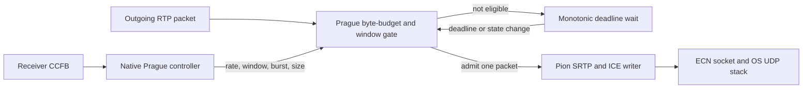

# Prague pacing scheduler: design and implementation

Status on 15 November 2026: the scheduler is implemented and three exploratory physical trials are captured; performance acceptance is incomplete. The [old runtime is archived](../../archive/prague-pacing-v1/README.md). Native congestion control and receiver CCFB behavior are held fixed. Linux lab unit/race/vet/build checks and macOS unit/race/vet/helper/build and local Prague/GCC media checks passed. On the actual sender, admission-only timing improved from 8.972 to 28.33 Mbps. [Physical Prague trials](../../results/preview/pion-prague-pacing-v2-25m-20261115T190910Z.md) averaged 13.120 Mbps steady frame throughput versus the saved GCC baseline's 18.357 Mbps. The ≥25 Mbps unshaped actual-media-output gate is not yet verified.

The new scheduler consumes the native **250 µs burst allowance**, rather than ticking every 250 µs. It deliberately differs from the demo sender's signed receive-wait compensation. See the [three-way formula and pacing comparison](pacing-algorithms.md) for the exact distinctions and numerical examples. The original per-packet Go timer described below is historical behavior, not the new implementation.

## Evidence and working hypothesis

The [latest captured pair](../../results/preview/pion-prague-vs-gcc-25m-20261115T172333Z.json) used the same 23.951 Mbps prerecorded source and 25 Mbps initial controller target. Prague's monitor frame rate was 8.814 Mbps; its median large-packet ingress gap was 1,171 microseconds. The last feedback state allowed 48.544 Mbps, with 23,636 accounted bytes in flight and a window of 115 reference packets of 1,200 bytes. Those snapshots do not show a configured 9 Mbps controller cap.

A separate reanalysis of the [earlier 28.9 Mbps source run](../../results/preview/prague-load-captured-20261114.json) found approximately 9.122 Mbps at each capture tap over the same 20-second interval. Its local derivation is retained under `results/raw/prague-load-30m-20261115T015241Z/monitor/throughput-vantage-check.json`. The plateau was already present at both monitor vantages. Neither analysis is a direct sender-NIC transmit measurement or a completed root-cause finding.

The leading hypothesis is that one-packet-per-wakeup scheduling, timer lateness, and synchronous producer backpressure limit the offered rate. Go documents platform-dependent [timer resolution](https://pkg.go.dev/time#hdr-Timer_Resolution), approximately 1 ms on Unix. At 30 Mbps, 1,200 accounted bytes require about 320 microseconds between transmissions; at 50 Mbps, about 192 microseconds. The precise interval uses the actual accounted packet size, including the adapter's overhead allowance.

Absolute deadlines or token accounting alone cannot solve a 1 ms wakeup floor while allowing only about one packet per wakeup. Accurate waiting and measured departure timing are essential parts of the proposal.

## Archived behavior versus implemented redesign

| Area | Archived implementation | New scheduler |
| --- | --- | --- |
| Rate accounting | After admission, sets `next = now + packetBytes / rate`; lateness is added to the sending schedule. | Maintains byte credit from elapsed monotonic time and the previously applied rate, with a strict burst cap. |
| Deadline | Relative wait recalculated from `next`. | Computes an absolute eligibility deadline from the remaining byte deficit; rechecks current state after every wakeup. |
| Linux waiting | Allocates a `time.NewTimer` for each wait. | Reuses a monotonic `timerfd` and an `eventfd` notifier, monitored together by `poll`; actual precision must pass a Linux benchmark. |
| Burst handling | Sends one packet per pacing opportunity; does not consume the exposed native `burst` output explicitly. | Translates native burst/size outputs into an explicit bounded byte allowance. Excess idle or late credit is discarded. |
| Window handling | Checks accounted bytes in flight against `window * size`, allowing at least one whole packet. | Preserves that independent admission gate; reports time blocked by it separately from pacing delay. |
| Feedback and close | Buffered notification channel and per-wait timer cancellation. | Wakes the active backend, then reevaluates rate/window/failure state. Shutdown joins only owned waits before releasing descriptors. |
| Observation | Native target, counters and feedback traces; no independent sender throughput series. | Adds applied-rate, budget, timer-lateness, wait-reason and accepted-byte metrics, plus sender-side capture validation. |
| Media source | Synchronous packet writes can slow the IVF frame producer. | Retains bounded backpressure for this patch and measures actual frame production and frame-send duration. |
| Observed result | Approximately 9 Mbps in earlier physical Prague runs. | Three new trials averaged 13.12 Mbps steady frame throughput and 13.22 ms mean per-trial P99 transit; substantial pacing/window waits remain. See the captured comparison and its limits. |

## Architecture and ownership

Keep one serialized sending path using the existing `sendMu`. The scheduler initially remains synchronous: it adds neither an asynchronous packet queue nor a persistent worker goroutine. This avoids changing packet-buffer ownership and media buffering at the same time as packet timing. The Go goroutine executing the packet write owns the active wait. Feedback processing remains concurrent, protected by `c.mu`.

The backend contract belongs to `internal/prague`: read the same monotonic time domain, wait until an absolute deadline, notify a state change, and close its resources. Inject a fake clock/waiter for deterministic tests. Keep kernel APIs behind Linux build tags; retain a reusable Go-timer backend for macOS/portable operation. Label the portable backend's achieved timing rather than assuming it can meet the Linux performance target.

Use a backend-owned signed 64-bit monotonic nanosecond counter for scheduler deadlines, controller elapsed time, feedback freshness and sent-packet timing. On Linux, read `CLOCK_MONOTONIC` directly, so the same numeric deadlines can arm `timerfd` without conversion from Unix wall time. The portable implementation uses elapsed monotonic time from a private Go `time.Now()` origin. Only time differences are compared between backends; recorded wall-clock anchors support capture correlation. Preserve the native core's wrapping microseconds-since-controller-start convention when converting the internal counter for cgo calls. Clock-read errors fail the run explicitly.

The proposed private interface is `NowNS`, `WaitUntilNS`, `Wake` and `Close`, all with explicit errors where an operation can fail. Only the serialized RTP writer calls `WaitUntilNS`; feedback and shutdown may call `Wake` concurrently. The fake backend implements this same contract. No backend stores an application context or owns an unjoined goroutine.

## Admission and budget rules

1. Acquire `sendMu`, determine the accounted packet size, and enter the admission loop. Packet size uses a documented byte basis consistent with the existing rate/window adapter. Record actual UDP datagram bytes separately; do not present the existing SRTP-overhead allowance as exact wire size.
2. Under `c.mu`, check closure, controller errors and feedback freshness. Accrue credit using elapsed monotonic time and the **previously applied** bytes/second rate before sampling the next native output. This prevents a new higher rate from retroactively crediting the preceding interval.
3. Read the current native rate, window, burst count and reference packet size. Keep bits/second at the application interface and bytes/second inside the scheduler. Preserve the native `GetCCInfo` time-dependent pacing adjustment; do not misclassify its roughly 3% phase changes as CE responses.
4. Clamp byte credit to a documented burst allowance derived conservatively from native `burst * size`, rounded only as needed to admit one whole RTP datagram. The reference burst horizon is 250 microseconds. Do not enlarge the allowance to one millisecond of traffic merely to hide a coarse timer. Record any whole-packet rounding exception and validate actual resulting bursts.
5. Apply both gates: enough byte credit **and** enough in-flight window space. Preserve the current whole-packet window rounding. A full byte budget does not override a full window; a free window does not override pacing.
6. If eligible, reserve packet/history accounting and debit credit under the lock, then release `c.mu` before the downstream write. Preserve the history-before-write ordering needed to handle prompt feedback. Count an attempt/admission separately from a successful writer return; any write error stops the run and is never reported as successful transmission.
7. If pacing-limited, derive the next eligibility deadline from the byte deficit. If window-limited, wait for feedback/close or the feedback-failure deadline. Release `c.mu` while waiting. A wakeup is a reason to reevaluate all gates, not permission to send using stale state.

Use integer or fixed-point credit with retained fractional bytes. Saturate idle time before multiplication to prevent integer overflow. Rate updates apply prospectively, and lower rates or burst limits clamp outstanding credit immediately. Credit remains bounded during idle periods and window stalls; late wakeups cannot produce an unlimited catch-up burst. Discarding excess lateness is deliberate: burst bounds take priority over recovering every missed byte of throughput.

For example, credit can be represented in billionths of a byte: refill by `previousRateBytesPerSecond * elapsedNanoseconds`, cap at `burstBytes * 1e9`, debit `packetBytes * 1e9`, and compute the missing wait with ceiling division by the applied bytes/second rate. Bound the elapsed interval at the time needed to fill the bucket before multiplying. Settle the old-rate credit under `c.mu` when feedback changes the applied rate/window, then wake the writer. Diagnostic snapshots report cached applied limits and their timestamp; a fresh native sample must be labeled separately.

## Linux wait backend

Use one nonblocking, close-on-exec `timerfd` based on `CLOCK_MONOTONIC` and one nonblocking, close-on-exec `eventfd` per Prague sender controller. Arm one-shot deadlines with `TFD_TIMER_ABSTIME`; wait for either descriptor with `poll`. These Linux APIs support file-descriptor-based timer and event notification: [timerfd](https://man7.org/linux/man-pages/man2/timerfd_create.2.html), [eventfd](https://man7.org/linux/man-pages/man2/eventfd.2.html).

- Keep the deadline and kernel timer in the same `CLOCK_MONOTONIC` nanosecond domain described above. Do not pass `time.Time.UnixNano()` to a monotonic timer. Test the conversion to native elapsed microseconds and retain wall-clock correlation uncertainty in the recording metadata.
- Drain expiry and notification counters, then return to the admission loop. Coalescing repeated notifications is acceptable because the loop reads current shared state. Preserve notifications arriving before the wait; avoid a drain-before-check sequence that loses a feedback or close event.
- Notify for changed feedback/window state, controller failure and close. A reduced rate must be checked before the next packet is admitted, even if an older timer also expires.
- Treat interrupted polling as a retry after checking closure. A saturated nonblocking event counter means a wake is already pending; other descriptor errors must propagate with context.
- Protect waiter entry/close with its own lifecycle state. Mark it closed and notify before waiting for active wait operations to return. Close descriptors only after those waits stop, preventing descriptor-reuse races. Do not wait for downstream network writes while holding `c.mu` or while the transport still needs closing.
- Register cleanup as each constructor resource is created; if the second descriptor or native-controller initialization fails, release every resource already owned. Keep `Close` idempotent across application and Pion-interceptor shutdown.
- Add no busy-spin loop or global runtime, NIC, qdisc, or CPU-affinity changes. Kernel timer expiration precision does not guarantee goroutine or on-wire departure precision; measure both CPU cost and observed timings.

A precise backend creation failure is an explicit preflight error when that backend was requested. A selected portable fallback must be visible in metadata. Do not silently label a coarse fallback as the precise backend.

## Source, accounting and diagnostics

Retain the fixed IVF source for the initial scheduler A/B so the patch changes one part of the sender. Record produced frames, `WriteSample` duration and sender-side frame age. Adaptive encoding and a common bounded frame-age policy across GCC/Prague remain separate work before a complete media-performance claim.

Expose these observations without adding an unbounded per-packet logging queue:

| Observation | Meaning |
| --- | --- |
| Cached applied native rate, window, burst, reference size, sample time | Distinguishes controller permission from measured socket output. |
| Pacing-wait and window-wait counts/durations | Identifies the active limiter. |
| Requested-wait sum and late-wake sum/count/maximum | Tests timing behavior; detailed lateness distributions still need a bounded trace or external capture. |
| Admitted bytes, writer-accepted bytes, failed writes | Distinguishes admission, successful API return and failure. |
| Media UDP datagram bytes and write timestamps | Observes output at the socket boundary; excludes STUN/DTLS/RTCP counters. |
| Frame production, frame-send blocking duration and ticker lateness | Detects backpressure changing offered load; ticker lateness is not decoded frame age. |
| Backend, OS/architecture, Go version, binary/source/dependency hashes | Makes the comparison reproducible. |

Use aggregate counters/histograms for normal runs and a bounded detailed trace for selected diagnostic intervals. Preserve truncation/sample-drop markers and the existing recording cap. Measure tracing overhead. A successful UDP write is kernel acceptance, not proof of NIC departure; retain an appropriately timestamped sender capture and compare it with the two monitor captures. Describe software versus hardware timestamp placement instead of claiming all captures are NIC-wire timestamps.

## Implemented files and interfaces

These files and flags now exist. The rules above remain the implementation specification; performance rollout is provisional:

| File | Implemented change |
| --- | --- |
| `internal/prague/controller.go` | Delegate admission timing to the budget/waiter, preserve history and feedback handling, expose applied limits and wait diagnostics. |
| `internal/prague/pacing_budget.go` | Monotonic elapsed-time accounting, byte credit, burst cap and eligibility deadline calculation. |
| `internal/prague/pacing_wait.go` | Small consumer-owned clock/wait/notify/close contract. |
| `internal/prague/pacing_wait_linux.go` | Reusable `timerfd`/`eventfd` backend and cancellation lifecycle. |
| `internal/prague/pacing_wait_portable.go` | Reusable Go timer backend and its documented timing limitations. |
| `cmd/pion-l4s/main.go`, `cmd/pion-l4s/ecn.go` | Sender backend selection, frame/socket observations and metadata. Receiver ECN/CCFB behavior stays fixed. |
| `scripts/testbed.py` and testbed config | Validate optional backend selection against binary capabilities before capture; record the choice. |
| Focused Go tests/benchmarks | Budget invariants, lifecycle/races, realistic wake delays and actual Linux pacing measurements. |

Keep `cc.BandwidthEstimator` compatible. Preserve existing callers of `prague.New` through optional configuration or an additional constructor. Any new CLI/backend field must be marked experimental, apply to the Prague sender only, and be recorded in the run manifest. Use the pinned original binary/source archive to reproduce the old implementation; a portable wait backend in the redesigned scheduler is not a substitute for that historical baseline. New source files and functions require purpose comments.

## Verification and rollout

1. **Deterministic scheduler checks.** Exercise variable packet sizes, fractional credit, idle periods, late wakeups, burst/window exhaustion, rate increases/decreases while waiting, notification races, feedback timeout, invalid ECN, downstream write errors and close. Assert both cumulative byte budgets and bounded bursts. Retain the existing duplicate/reordered feedback, loss recovery and sequence-wrap checks.
2. **Real Linux pacing measurement.** Compare the original and proposed scheduler on the same host. First isolate the scheduler with fixed rate outputs, a defined window and timely synthetic acknowledgments. Measure requested/actual waits, accepted-byte rate, departure gaps, bursts, CPU and allocations. Fake-clock tests cannot establish OS timer precision.
3. **Whole-Pion check without a capacity bottleneck.** Supply a measured source of about 30 Mbps and a controller allowance of at least that rate. Retain realistic feedback/RTT conditions and report window blocking. A near-zero-RTT loopback path with 20 ms CCFB can itself become window/feedback-limited, so it is not automatically a valid high-rate pacer test. Use owned test fixtures; changing shared lab settings is a separate action.
4. **Acceptance gate.** Demonstrate at least 25 Mbps actual media output on that sufficiently provisioned test path, within the recorded rate/window/burst policy, without hidden queue growth, invalid-ECN/feedback regressions or close leaks. This is a proposed gate, not an achieved result or a promise of 25 Mbps through a 20 Mbps bottleneck. Run the repository checks, relevant benchmarks and race checks when the implementation exists.
5. **Physical comparison and rollout.** Three explicitly requested exploratory Prague trials have been contrasted with the saved three-trial GCC baseline. They retain SDP/CCFB traces, sender timing and both capture points, but do not satisfy full rollout acceptance: live shaping and background traffic remain unverified and final feedback tails need reconciliation. A controlled pair after the acceptance gate must use the same verified bottleneck, source and load profile, including final feedback processing. Report throughput alongside sender waiting, transit/queue delay, CE and loss. The scheduler patch alone does not complete encoder adaptation or establish performance superiority.

If the Linux backend still cannot meet the timing gate under the native burst bounds, keep the result provisional and evaluate packet scheduling in the Linux networking stack as a separately specified backend. Enlarging bursts or weakening the congestion window to make a throughput graph rise is not an acceptable substitute.

## Source pointers

- [Current admission loop](../../internal/prague/controller.go), `Controller.AddStream`, and [bounded budget](../../internal/prague/pacing_budget.go).
- [Archived per-packet timer source](../../archive/prague-pacing-v1/README.md).
- [Linux backend](../../internal/prague/pacing_wait_linux.go), [portable backend](../../internal/prague/pacing_wait_portable.go) and [timing benchmark](../../internal/prague/pacing_test.go).
- [Native bridge](../../internal/prague/bridge.cc) and [burst/rate/window definitions](../../internal/prague/native/prague_cc.h).
- [Native pacing phase and burst horizon](../../internal/prague/native/prague_cc.cpp), `GetCCInfo`, `BURST_TIME` and `RATE_OFFSET`.
- [Existing feedback and shutdown tests](../../internal/prague/controller_test.go).
- [Recorded controller handoff](recordings.md) and [experiment completion criteria](../../.agents/skills/pion-prague-testbed/references/completion.md).
