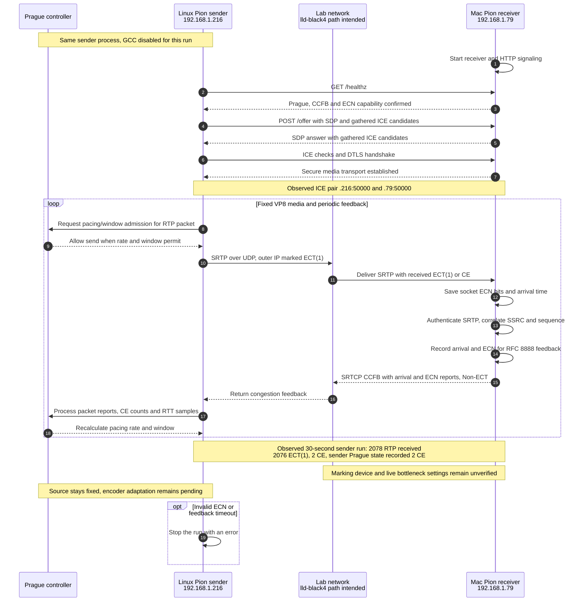

# Prague controller and ECN lab integration

The `feat/prague-cc-testbed` branch implements `--controller prague` on both
Pion peers. This is an experimental integration for the direct IPv4 lab path.
The separate server-side host is now installed at `selabs@192.168.1.216` on
`enp1s0`, with the Mac receiver at `192.168.1.79` on `en7`. A two-host check has
observed media delivery and CE feedback into Prague; full congestion validation
and independent bottleneck path/settings evidence remain pending.

## Sequence diagram

Rendered previews: [PNG](../images/pion-prague-sequence.png) and
[SVG](../images/pion-prague-sequence.svg). See [SDP and feedback recordings](recordings.md)
for the offer/answer artifacts and actual Pion controller-dispatch trace.

This sequence describes the experimental Prague/CCFB call between the physical
Linux sender and Mac receiver. The network participant represents the intended
lab path; the exact forwarding path, active qdisc and device introducing CE
still need independent operator evidence. Initial signaling arrows are logical
exchanges between endpoints.



The rate/window update is implemented; this diagram does not claim a measured
rate reduction or sustained congestion response in the light-load physical run.
The error branch shows the implemented failure policy, rather than an error
observed in that run. General SDP ECN negotiation and dynamic controller fallback
remain pending. See the [recorded run](../../results/preview/prague-lab-selabs216-20261114.json).

## Controller and packet path

- `internal/prague/native/` vendors the unmodified Apache-2.0 UDP-Prague core
  at commit `46986fb95f1fdd17bf6225a0afb35f073eb7b7d9`.
- A small cgo wrapper uses continuous mode, disables optional startup, and
  supplies a monotonic clock, positive RTT samples and cumulative packet counters.
  Controller rates are bytes/s internally and bits/s at the application API.
- The sender implements Pion's `cc.BandwidthEstimator`. It serializes RTP writes
  against the reference pacing rate and a conservative byte window derived from
  `packet_window * packet_size`. One packet is sent per pacing opportunity, within
  the reference burst ceiling. Existing RTP packetization is retained; this is a
  byte-window adaptation, not a reproduction of the example's packet-size loop.
- Writes block instead of collecting an unbounded application packet queue.
  Acknowledged/lost history is retained for one second for duplicate/late report
  correction. The history is capped at 32768 entries, below half the RTP sequence
  space. Old unreported packets are declared lost while fresh feedback is arriving.
- A dedicated UDP socket is bound to the selected lab IP and a port in the
  configured range, then supplied to Pion's ICE UDP mux. The socket serializes
  TOS updates, preserves DSCP, and marks only SRTP data ECT(1). STUN, DTLS and RTCP
  use Non-ECT. The current transport is for macOS/Linux IPv4 UDP host candidates.
- The receiver reads ancillary `IP_RECVTOS` metadata and the arrival time before
  ICE/SRTP processing. It correlates these with the visible RTP SSRC/sequence,
  consumes them only after SRTP authentication, and reuses Pion's CCFB recorder.
  Reports contain the observed ECN bits, rather than the stock generator's zero.
- The sender subtracts each packet's RFC 8888 arrival-time offset from elapsed
  send-to-feedback time to obtain an RTT sample. Peer clocks need not match.
  Duplicate feedback does not increment counters again; a late received report
  can undo provisional loss. CE counts and controller alpha/rate/RTT are logged.

GCC is instantiated only for `--controller gcc`. A Prague sender checks the
receiver's `/healthz` for matching Prague/CCFB/ECN support before signaling.
This is explicit agreement between this project's two lab applications, not
general RFC 6679 SDP ECN negotiation. Arbitrary browser interoperability and
full RFC conformance remain unverified.

Non-ECT/ECT(0) feedback, two seconds without fresh feedback, missing ECN metadata,
or history exhaustion ends the media run with an error. This integration stops
on ECN failure instead of dynamically switching controllers in the same session.

## Pacing scheduler implementation and validation

The [scheduler design](pacing-scheduler-design.md) is implemented locally with bounded elapsed-time byte credit, native-derived burst limits and a Linux monotonic timerfd/eventfd wait backend. macOS uses a reusable portable Go timer. The native 250 µs value sizes the burst; it is not a fixed packet timer. See [all three algorithms and formulas](pacing-algorithms.md) for the archived approximately 9 Mbps system, new Pion scheduler and upstream UDP Prague demo, including their different late-wakeup behavior.

The [old runtime archive](../../archive/prague-pacing-v1/README.md) preserves the original implementation. Unit, race, vet, helper and local media checks pass. On the Linux lab sender, the fixed-rate admission benchmark improved from 8.97 to 28.33 Mbps. [Three captured physical trials](../../results/preview/pion-prague-pacing-v2-25m-20261115T190910Z.md) reached 13.12 Mbps mean steady frame rate against the saved GCC baseline's 18.36 Mbps. Prague had lower observed transit tails and no unmatched RTP identities between the taps; qdisc/capacity, background traffic, feedback tails and the ≥25 Mbps unshaped actual-output gate remain limitations. Select the experimental sender backend with `--prague-pacing-backend auto|portable|linux-timerfd`; `auto` selects timerfd on Linux. Explicit `linux-timerfd` fails on unsupported platforms. In testbed JSON use `"prague_pacing_backend": "linux-timerfd"` for a Prague Linux sender; the receiver ignores this sender-only field.

## Build and local verification

Install Go 1.24+, a C++11 compiler and cgo support. macOS uses Clang/libc++;
Linux needs `g++`/libstdc++. The scripts allow `-fwrapv` for the reference core's
signed timestamp/counter arithmetic.

```sh
bash scripts/build.sh
bash scripts/check.sh
bash scripts/make-media.sh  # once, if media/sample.ivf is absent
python3 scripts/local-smoke.py --controller prague --video media/sample.ivf
```

For direct Go commands use `CGO_ENABLED=1 CGO_CXXFLAGS_ALLOW=-fwrapv` and
`GOWORK=off`. Loopback checks create evidence under ignored `results/raw/`.

Tests exercise CE-driven rate reduction, RTP sequence wrap, duplicates, late loss
recovery, invalid ECN, feedback timeout, shutdown, and actual socket ECN values
surviving RFC 8888 serialization. Local VP8 transfer has also been checked with
both Prague/CCFB and the GCC/CCFB baseline. Local CE tests do not establish
DualPI2 marking or performance.

## Physical testbed run

Use the [two-host guide](testbed.md). Copy `testbed/lld-black4.example.json` to
`testbed/local.json`, set `controller` to `prague`, leave `feedback` as `ccfb`,
and fill both host addresses and interface names. Use the same config/source
on both hosts. A receiver must also run with `--controller prague`.

```sh
# Receiver laptop, behind lld-black4
python3 scripts/testbed.py plan
python3 scripts/testbed.py doctor --role receiver
python3 scripts/testbed.py run --role receiver --run-id prague-01

# Separate sender host on the servers switch
python3 scripts/testbed.py doctor --role sender
python3 scripts/testbed.py run --role sender --run-id prague-01
```

On 14 November at 17:00 PST, a 30-second Prague/CCFB sender run completed with
exit code 0 from the separate Ubuntu host to the Mac. The selected ICE pair was
`192.168.1.216:50000` ↔ `192.168.1.79:50000`. Receiver counters reached 2,078 RTP
packets: 2,076 ECT(1), 2 CE and 0 Non-ECT. The sender's last periodic sample
recorded 924 congestion-feedback reports and 2 CE in Prague state, with no
controller failure. Sender and receiver counters have independent sampling
times; they are not a synchronized final packet accounting or loss measurement.

The user confirms the Mac's attachment behind lld-black4 and the server's
attachment to the servers switch. The active qdisc, shaping settings, marking
device and transparent forwarding path still need operator captures/counters.
The supplied diagram's `.75` is management, not a Pion peer. No Pion program
was installed on EdgeRouterX or a switch. See the [current setup overlay](../images/pion-current-lab-setup.md)
and [run summary with hashes and samples](../../results/preview/prague-lab-selabs216-20261114.json).

The sender lives at `/home/selabs/pion-l4s-interop` and uses a private Go toolchain
through `./run-testbed.sh`. Its build, unit/race checks, vet, nine Python runner
tests and server-local Prague check passed before the physical call. Installation
was under the user's home directory, without changes to lab equipment or qdiscs.

The fixed 500 kbps sample establishes transport at light load. A controller
target can exceed offered media rate on this application-limited source; it is
not measured link capacity. Frame production can slow while the synchronous
Prague pacer waits. Adaptive encoding, bounded latency under changing capacity,
loaded-link fairness, queue telemetry and complete POC metrics remain work to do.
The physical result above establishes the endpoint ECN feedback loop. It does
not establish sustained congestion response, capacity, fairness or RFC conformance.
