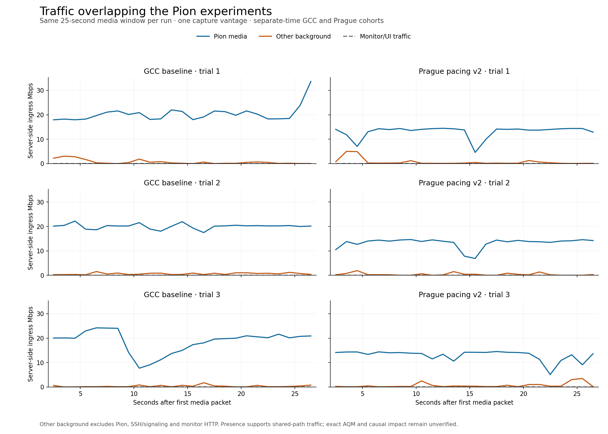

# Evidence of traffic overlapping the Pion media experiments

Additional IP traffic was present during the actual media interval, beyond the Pion flow and its signaling, SSH and monitor UI traffic. These are passive observations; no new transport run or capture was started.

| Condition | Trial | Other background entering monitor, Mbps | Delivered background, Mbps | Peak ingress over 1 s, Mbps | Background packets matched at both sides |
| --- | ---: | ---: | ---: | ---: | ---: |
| GCC baseline | [1](http://lld-black4.local/data/pion-gcc-baseline-25m-20261115T181607Z-r1_2026_11_15_19_21/) | 0.704 | 0.692 | 3.069 | 4,334 |
| GCC baseline | [2](http://lld-black4.local/data/pion-gcc-baseline-25m-20261115T181607Z-r2_2026_11_15_19_22/) | 0.657 | 0.654 | 1.540 | 3,115 |
| GCC baseline | [3](http://lld-black4.local/data/pion-gcc-baseline-25m-20261115T181607Z-r3_2026_11_15_19_24/) | 0.370 | 0.369 | 1.746 | 2,391 |
| Prague pacing v2 | [1](http://lld-black4.local/data/pion-prague-pacing-v2-25m-20261115T190910Z-r1_2026_11_15_20_11/) | 0.714 | 0.717 | 5.015 | 2,915 |
| Prague pacing v2 | [2](http://lld-black4.local/data/pion-prague-pacing-v2-25m-20261115T190910Z-r2_2026_11_15_20_13/) | 0.416 | 0.416 | 1.923 | 4,082 |
| Prague pacing v2 | [3](http://lld-black4.local/data/pion-prague-pacing-v2-25m-20261115T190910Z-r3_2026_11_15_20_14/) | 0.670 | 0.670 | 3.476 | 4,496 |
| Latest Prague repeat | [1](http://lld-black4.local/data/new-pion-v2-repeat-25m-20261115T193712Z_2026_11_15_20_37/) | 0.159 | 0.155 | 1.309 | 695 |

[Detailed measurements and identified flows](cross-traffic-overlap-20261115.json) · [Summary CSV](cross-traffic-overlap-20261115.csv)

## Method

Common 25-second interval, seconds 2–27 after first ingress media, separately for each run. Rates use captured original frame lengths and one vantage at a time, not sums of unequal per-flow averages.

Background means other IPv4/IPv6 unicast traffic directed to the same receiver Ethernet MAC. Source/destination transport identifiers and matched packet prefixes show that additional flows were present at both monitor interfaces. The parser was checked against the saved VP8 packet counts for each run.

## Interpretation

This confirms uncontrolled shared-path background traffic, including TCP connections outside the Pion peer pair. It can affect available capacity, marking, loss and delay, and its rate can differ between separate-time cohorts. It does not identify a particular application, person or controlled competitor, establish queue classification, or by itself explain each congestion event.

- NSI=enp2s0 and CMCI=enp3s0 are the recorded capture-vantage mapping. Live AQM mode/capacity are not independently established.
- Client-bound background shares the monitored forwarding path; this does not prove a particular queue classification or causal contribution to each CE/loss event.
- Unknown encrypted application traffic is classified by transport/IP/ports, not by guessed website or app. Extra flows are not proof of another participant or of deliberate controlled competing traffic.
- Broadcast, multicast and non-IP frames are excluded. Metrics are therefore a conservative unicast/IP subset of competing traffic.
- Background packet correspondence uses normalized captured IP headers/prefixes and a bounded timestamp window; counts are evidence of common forwarding, not definitive background-loss accounting.
