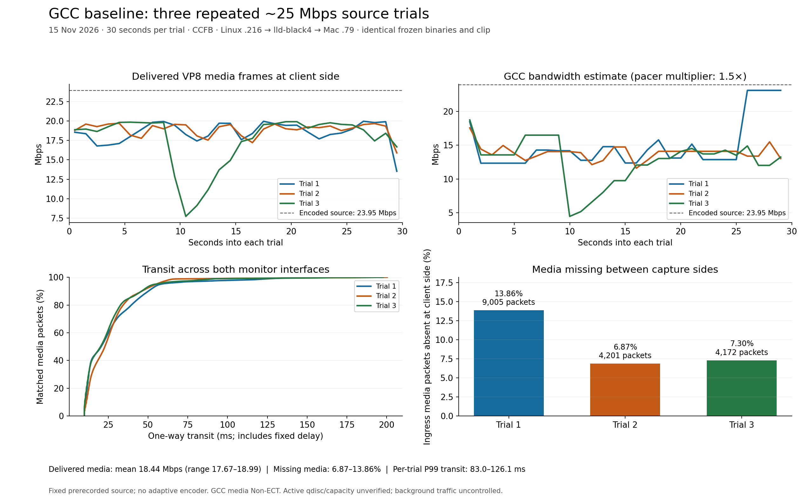

# GCC baseline: three repeated approximately 25 Mbps source trials

These trials provide a repeatable fixed-source transport reference while the Prague pacing ceiling is investigated.

Source revision: `0059d63a5285e17d022a0df1c210b5997fa13d01`. VP8: 1280×720, 60 fps, 23.950988 Mbps encoded payload, 25 Mbps initial controller target. All trials used GCC with RFC 8888 CCFB.

Source SHA-256: `cbe29e3da7d7b256fed6b7e7aff519d9263900d15d4b9a05459331e15f975f2b`.

| Trial | Delivered media Mbps | Steady media Mbps | Missing media | Transit P50 / P99 ms |
| --- | ---: | ---: | ---: | ---: |
| 1 | 18.663 | 18.662 | 9,005 (13.863%) | 20.539 / 126.086 |
| 2 | 18.994 | 18.936 | 4,201 (6.868%) | 22.879 / 82.953 |
| 3 | 17.665 | 17.474 | 4,172 (7.298%) | 20.177 / 92.573 |

Across three trials, delivered media averaged **18.441 Mbps**, sample standard deviation **0.692 Mbps**, range **17.665–18.994 Mbps**.

Delivered media rates include packet headers. The steady window is seconds 2–27. Transit includes fixed delay. GCC CE was zero in all three captures because all selected media was Non-ECT; sender CE is unavailable.

[Summary CSV](pion-gcc-baseline-25m-20261115T181607Z.csv) · [Full measurements and provenance](pion-gcc-baseline-25m-20261115T181607Z.json)

## Evidence and capture links

- Trial 1: [pion-gcc-baseline-25m-20261115T181607Z-r1](http://lld-black4.local/data/pion-gcc-baseline-25m-20261115T181607Z-r1_2026_11_15_19_21/), started 2026-11-15T10:21:20.644925-08:00. [Local packet and endpoint evidence](../raw/pion-gcc-baseline-25m-20261115T181607Z-r1/analysis.json).
- Trial 2: [pion-gcc-baseline-25m-20261115T181607Z-r2](http://lld-black4.local/data/pion-gcc-baseline-25m-20261115T181607Z-r2_2026_11_15_19_22/), started 2026-11-15T10:22:43.754866-08:00. [Local packet and endpoint evidence](../raw/pion-gcc-baseline-25m-20261115T181607Z-r2/analysis.json).
- Trial 3: [pion-gcc-baseline-25m-20261115T181607Z-r3](http://lld-black4.local/data/pion-gcc-baseline-25m-20261115T181607Z-r3_2026_11_15_19_24/), started 2026-11-15T10:24:06.891741-08:00. [Local packet and endpoint evidence](../raw/pion-gcc-baseline-25m-20261115T181607Z-r3/analysis.json).

## Reusing the baseline

For a future Prague comparison, preserve this source hash, initial target, endpoint placement, feedback format, duration and analysis windows. Record the new binary revision and obtain current bottleneck settings. Repeat Prague three times and compare the distribution of outcomes rather than one favorable sample. The existing background traffic was not controlled, so these captures cannot establish a controller-only causal difference.

## Limits and remaining evidence

- Three new GCC/CCFB trials, 30 seconds each, fresh receiver and separate 60-second monitor capture for every trial. Earlier GCC/Prague comparison runs are not pooled into these statistics.
- Identical frozen endpoint binaries from source commit 0059d63a5285e17d022a0df1c210b5997fa13d01 and identical 23.950988 Mbps VP8 IVF source; initial controller target 25 Mbps in every trial.
- GCC only was selected. Its media was Non-ECT at the egress capture. CE=0 is therefore expected; sender CE is unavailable rather than evidence of an uncongested path.
- The pinned Pion GCC LeakyBucketPacer uses a 5 ms ticker and SetTargetBitrate applies a 1.5 multiplier to estimator updates. The plotted GCC bandwidth estimate is not a strict wire-rate cap; its pacer and packet overhead can produce a higher transmitted rate.
- Mean delivered media frame rate uses one client-side capture vantage and includes Ethernet/IP/UDP/SRTP headers. Monitor UDP frame averages use the monitor-defined flow interval and include control traffic, so their numerical values can differ.
- The common steady window is 2 through 27 seconds after each first ingress media packet. One-second delivered-rate plots use the first ingress media packet as time zero. Target-rate plots use approximately aligned one-second sender metrics.
- The endpoint limit is configured as 30 seconds; process shutdown and buffered-packet drain can extend the complete media interval. The plots show the first 30 seconds, whole-media rates use the actual captured interval, and steady comparisons use the common 25-second window.
- Missing media packets are unique VP8 RTP identities seen at NSI and absent at CMCI, divided by the ingress unique-media count. Monitor UDP drops also include non-media datagrams; controller loss estimates and end-to-end playback loss are separate quantities.
- Paired one-way transit includes fixed propagation/emulation delay and is not pure queue delay. P50 and P99 statistics below summarize per-trial quantiles, not a pooled packet quantile.
- Capture interface mapping was checked live: NSI=enp2s0 and CMCI=enp3s0. Active DualPI2/SRM mode, configured shaping capacity and queue telemetry were not independently verified.
- No controlled competing traffic was added. Existing lab and endpoint background traffic was uncontrolled. These are repeated fixed-source transport baselines, not completed adaptive-video performance validation.
- Bulk capture downloads were deferred until all three trials finished. Only this task's endpoint processes were stopped; the original local config and shared network settings were preserved.

The GCC transport baseline is recorded. Full experiment completion still requires verified qdisc settings, adaptive source control, pure queue-delay and raw RTT measurements, application goodput, and controlled matched Prague trials.
