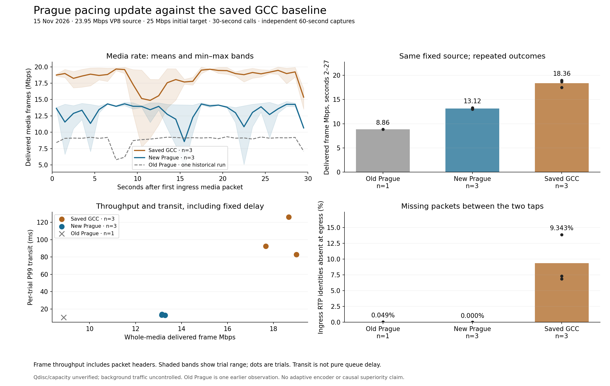

# New Prague pacing versus saved GCC baseline

Three physical Prague/CCFB trials used the new frozen scheduler. Each 30-second call had a fresh receiver and a separate 60-second bottleneck capture.

| Condition | Trials | Steady frame Mbps, mean (range) | Missing RTP %, mean | Mean per-trial P99 transit ms |
| --- | ---: | ---: | ---: | ---: |
| New Prague | 3 | 13.120 (12.970–13.294) | 0.000 | 13.217 |
| Saved GCC | 3 | 18.357 (17.474–18.936) | 9.343 | 100.537 |

Historical old Prague: one earlier run, steady frame rate 8.856 Mbps. It is not pooled into the new three-trial cohort.

[Measurements and provenance](pion-prague-pacing-v2-25m-20261115T190910Z.json) · [CSV](pion-prague-pacing-v2-25m-20261115T190910Z.csv) · [Saved GCC baseline](pion-gcc-baseline-25m-20261115T181607Z.md)

## New trial details

| Trial | Steady frame Mbps | Monitor CE / sender processed CE | Pacing / window wait seconds, last feedback | Outcome |
| --- | ---: | ---: | ---: | --- |
| [1](http://lld-black4.local/data/pion-prague-pacing-v2-25m-20261115T190910Z-r1_2026_11_15_20_11/) | 13.097 | 2213 / 2213 | 15.328 / 12.668 | sender 0; receiver 1 |
| [2](http://lld-black4.local/data/pion-prague-pacing-v2-25m-20261115T190910Z-r2_2026_11_15_20_13/) | 13.294 | 2606 / 2599 | 15.682 / 12.335 | sender 0; receiver 1 |
| [3](http://lld-black4.local/data/pion-prague-pacing-v2-25m-20261115T190910Z-r3_2026_11_15_20_14/) | 12.970 | 2478 / 2476 | 15.584 / 12.429 | sender 0; receiver 0 |

Pacing/window waits are cumulative sender observations, not network latency. Receiver errors and capture-loss diagnostics are preserved in JSON.

The historical plateau was exceeded in all three new trials. GCC still delivered more frame throughput, while new Prague had lower observed transit tails and missing-packet counts. These separate-time cohorts do not isolate a controller-only effect.

The last feedback states show approximately 15.3–15.7 seconds of pacing waits and 12.3–12.7 seconds of window waits. Large-packet median ingress gaps are now 419–428 µs versus about 1,171 µs in the old Prague run. Timing improved; window/feedback interaction remains a material limiter to investigate. No native window or CCFB policy was changed during this batch.

## Interpretation and remaining limits

- Three new Prague trials are contrasted with three previously collected GCC trials, not a new interleaved randomized comparison.
- Same source hash, 25 Mbps initial target, hosts/interfaces, CCFB format, duration and steady window; binary changes are explicitly recorded.
- Frame throughput includes Ethernet/IP/UDP/SRTP overhead; it is not encoded-payload goodput. The steady window is seconds 2 through 27 after first ingress media.
- Transit includes fixed network/emulation delay; active DualPI2/SRM mode, capacity and pure queue delay remain unverified.
- No controlled competing traffic was generated. Existing background traffic was uncontrolled and can differ from the saved baseline.
- New sender metrics count UDP acceptance and pacing/window waits; UDP success is not a NIC departure timestamp. Saved GCC has no equivalent socket series.
- The source is a fixed prerecorded VP8 clip. Adaptive encoder targets, raw RTT variation and deduplicated application-payload goodput are unavailable.
- Receiver closed-pipe shutdown errors are retained separately from successful bounded sender completion; periodic receiver counters need not be final.
- Monitor CE / last recorded sender CE are 2213/2213, 2606/2599 and 2478/2476. The 7- and 2-mark tails have not been reconciled; the last feedback state is not final drained accounting.
- Capture diagnostics report one flushed interface packet per side per trial; zero unmatched media identities applies to the retained captures, not an independently measured physical loss guarantee.
- The >=25 Mbps unshaped actual-media acceptance gate remains incomplete; a 28.33 Mbps lab admission benchmark does not satisfy it.

Source and algorithm details: [three pacing formulas](../../docs/pion-l4s-interop/pacing-algorithms.md). The upstream UDP demo executable was not run; it remains an algorithm reference.
