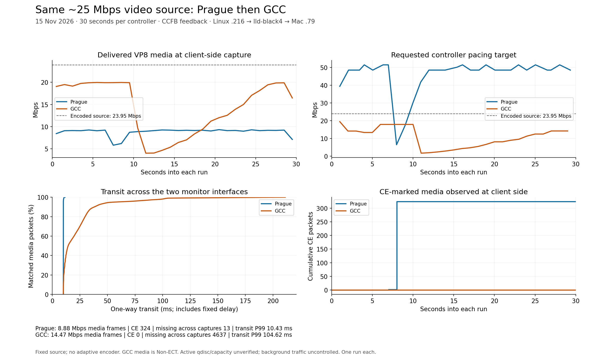

# Prague versus GCC: approximately 25 Mbps source

One physical transport run per controller, Prague first, on 15 November 2026.

Source: 23.950988 Mbps VP8, 1280×720 at 60 fps; identical SHA-256 `cbe29e3da7d7b256fed6b7e7aff519d9263900d15d4b9a05459331e15f975f2b`.

| Controller | Monitor UDP Mbps | VP8 frame Mbps | Steady VP8 Mbps | CE at egress / sender | Missing RTP across captures | Transit P50 / P99 ms |
| --- | ---: | ---: | ---: | ---: | ---: | ---: |
| prague | 8.814 | 8.876 | 8.856 | 324 / 324 | 13 | 10.014 / 10.428 |
| gcc | 14.341 | 14.472 | 13.473 | 0 / n/a | 4637 | 14.380 / 104.620 |

GCC sender CE is unavailable because that mode does not use the application ECN feedback adapter. Capture CE=0 is a measured value; sender CE=null is unavailable.

## Observations

GCC delivered more media frames (14.47 versus 8.88 Mbps), with a larger missing-media fraction (9.66% versus 0.049%) and higher transit delay in these captures.

All 324 Prague CE marks were newly observed between the two capture sides and reached the recorded sender controller state. GCC media was entirely Non-ECT, so its zero CE count does not imply absence of congestion.

Prague also observed 13 losses. Its rate response includes CE and loss handling; this was not a CE-only experiment. Its lower delivered rate also makes the latency difference unsuitable as an isolated proof of controller superiority.

[Summary CSV](pion-prague-vs-gcc-25m-20261115T172333Z.csv) · [Full measurements and provenance](pion-prague-vs-gcc-25m-20261115T172333Z.json)

- [prague monitor results](http://lld-black4.local/data/pion-compare-25m-20261115T172333Z-prague_2026_11_15_18_34/), started 2026-11-15T09:34:20.870552-08:00.
- [gcc monitor results](http://lld-black4.local/data/pion-compare-25m-20261115T172333Z-gcc_2026_11_15_18_35/), started 2026-11-15T09:35:41.061122-08:00.

## Interpretation limits

- One Prague run followed by one GCC run; 30 seconds each, with separate 60-second captures. No repetitions or controlled competing traffic.
- Same 23.950988 Mbps prerecorded VP8 clip and 25 Mbps initial target; no adaptive encoder. Actual source frame production can be slowed by pacing/backpressure.
- Prague uses application ECT(1)/ECN-aware CCFB; GCC uses CCFB without the application ECN socket. These are complete transport modes, including their different pacers.
- Capture interface mapping was read live: NSI=enp2s0, CMCI=enp3s0. Shaping capacity, active DualPI2/SRM mode and queue telemetry were not independently verified.
- Monitor frame throughput includes headers. VP8 frame throughput filters negotiated media payload types at one egress vantage; it is not decoded-video goodput.
- Paired transit includes fixed propagation/emulation delay and is not pure queue delay. Missing RTP identities across captures are reported separately from monitor UDP drops and provisional controller loss.
- The steady comparison window is 2 to 27 seconds after the first ingress media packet in each capture. One-second throughput bins use that same ingress media origin.
- Controller target series is aligned approximately using one-second sender metric samples; it is not packet-synchronized with the capture timeline.
- Endpoint periodic counters may omit a tail; packet counts and ECN reconciliation use both complete PCAPNG vantages. Sender CE uses the last recorded feedback dispatch, not merely the last periodic metric.
- Prague had both CE and packet loss in this run; its native controller responds to both, so rate changes cannot be attributed solely to CE. The roughly 9 Mbps sender pacing ceiling also remains a confounder.
- Both capture logs report pcap:0 and dumpcap:0 dropped packets; each interface flushed one packet at shutdown, well after the bounded media interval. The monitor lacks snmpwalk, so DOCSIS MIB telemetry was unavailable.

Pure queue delay, deduplicated application goodput, raw RTT variation and an adaptive encoder target remain unavailable. These two runs do not complete the full performance-validation matrix.
